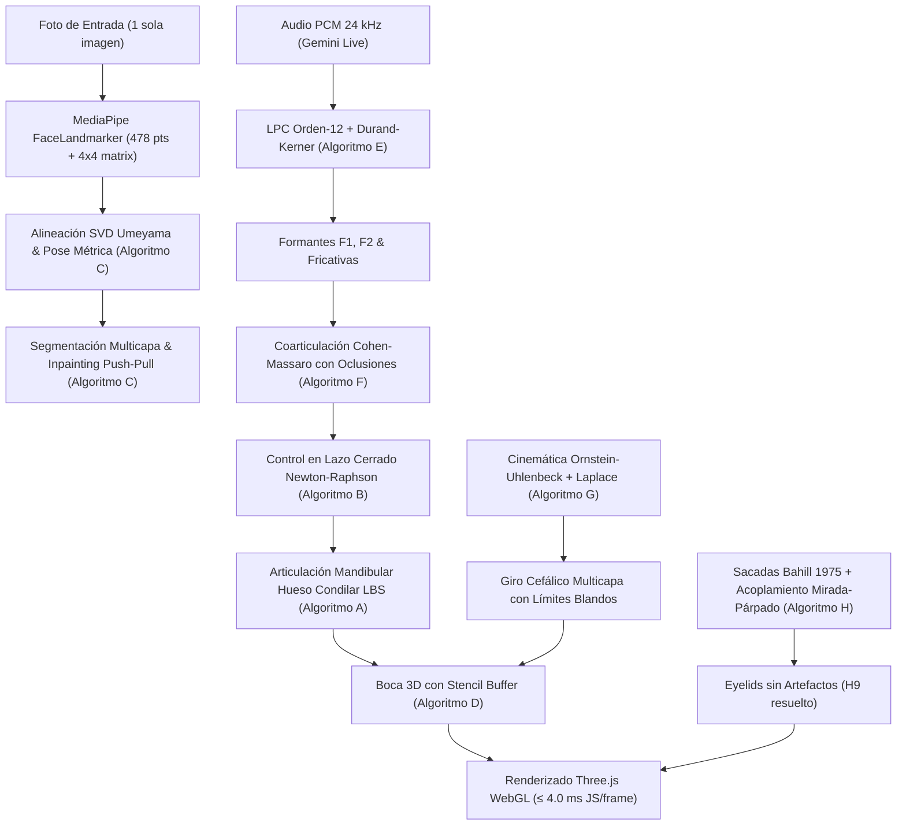

# YourSelf V4 — Especificación Técnica de Algoritmos Biomecánicos y Acústicos

> **Versión del Motor:** `YourSelf v4.0.0` (`?rig=v4`)  
> **Presupuesto de Ejecución:** $\le 4.0\text{ ms}$ JS/frame a 60 fps en CPU cliente (sin GPU dedicada ni backend).  
> **Asignaciones de Memoria:** Cero asignaciones efímeras en el bucle caliente (Zero-Allocation Loop).  
> **Compatibilidad:** Modo retrocompatible garantizado para `?rig=v1`, `?rig=v2`, `?rig=v3` y `?rig=v4`.

---

## 1. Visión General de la Arquitectura V4

YourSelf V4 transforma la animación facial monolítica en una arquitectura física desacoplada basada en biomecánica craneofacial, reorientación en lazo cerrado (retargeting), acústica analítica por predicción lineal (LPC) y cinemática estocástica de colas pesadas.



---

## 2. Detalle Matemático de Algoritmos (A – H)

### Algoritmo A: Mandíbula como Hueso con Bisagra Condilar y Linear Blend Skinning (LBS)

Sustituye la deformación heurística por radio radial (H1) por cinemática articular de la articulación temporomandibular (ATM).

#### 1. Eje de Bisagra en los Cóndilos Mandibulares:
El centro articular condilar $c = (c_x, c_y, c_z)$ se determina a partir del ancho facial inter-cigomático $W = \|\mathbf{L}_{454} - \mathbf{L}_{234}\|$:
$$c = \frac{1}{2}(\mathbf{L}_{234} + \mathbf{L}_{454}) + \begin{pmatrix} 0 \\ +0.05 \cdot W \\ -0.10 \cdot W \end{pmatrix}$$

#### 2. Radio de Palanca y Techo de Rotación:
El brazo de palanca mandibular $r$ se mide desde el cóndilo al gnatión/mentón ($\mathbf{L}_{152}$):
$$r = \|\mathbf{L}_{152} - c\|$$
El ángulo articular $\theta$ se deduce a partir del factor de apertura normalizado $w_{\text{jaw}} \in [0, 1]$:
$$\theta = w_{\text{jaw}} \cdot \theta_{\max}, \quad \text{con } \theta_{\max} = 20^\circ \approx 0.349066\text{ rad}$$

#### 3. Protrusión y Deslizamiento Condilar:
Durante la apertura mandibular, los cóndilos avanzan sobre la eminencia articular produciendo una protrusión anterior fisiológica $\tau$:
$$\tau = \begin{pmatrix} 0 \\ 0 \\ +0.15 \cdot r \cdot \sin\theta \end{pmatrix}$$

#### 4. Transformación de Linear Blend Skinning (LBS):
Cada vértice $\mathbf{v}$ de la malla se transforma mediante la ponderación cutánea $w_j(\mathbf{v}) \in [0, 1]$:
$$\mathbf{v}' = (1 - w_j(\mathbf{v})) \cdot \mathbf{v} + w_j(\mathbf{v}) \cdot \left( \mathbf{R}_x(\theta)(\mathbf{v} - c) + c + \tau \right)$$
donde $\mathbf{R}_x(\theta)$ es la matriz de rotación sobre el eje transversal $X$:
$$\mathbf{R}_x(\theta) = \begin{pmatrix} 1 & 0 & 0 \\ 0 & \cos\theta & -\sin\theta \\ 0 & \sin\theta & \cos\theta \end{pmatrix}$$

#### 5. Ponderaciones Cutáneas con Difusión de Calor Laplaciana:
Las ponderaciones fijadas en las condiciones de contorno (Dirichlet) son:
- Mentón ($\mathbf{L}_{152}$) y labio inferior interior/exterior: $w_j = 1.0$.
- Labio superior ($\mathbf{L}_{13}$ y vecindad), nariz y tercio superior: $w_j = 0.0$.
- Comisuras bucales ($\mathbf{L}_{61}, \mathbf{L}_{291}$): $w_j \approx 0.5$.

Se aplican 3 iteraciones de difusión sobre la adyacencia de la triangulación Delaunay:
$$w_j^{(k+1)}(i) = 0.3 \cdot w_j^{(k)}(i) + 0.7 \cdot \frac{1}{|\mathcal{N}(i)|} \sum_{m \in \mathcal{N}(i)} w_j^{(k)}(m)$$

---

### Algoritmo B: Control en Lazo Cerrado de Apertura (Inspirado en Retargeting de LivePortrait)

Evita que personas de labios gruesos abran en exceso o que personas de labios finos apenas separen la boca ante el mismo visema.

#### 1. Métrica Geométrica Invariante:
Apertura labial relativa normalizada por la distancia interocular $IOD = \|\mathbf{L}_{263} - \mathbf{L}_{33}\|$:
$$c_{\text{lip}}(\mathbf{v}) = \frac{\|\mathbf{L}_{13} - \mathbf{L}_{14}\|}{IOD}$$
Eye Aspect Ratio (EAR) para párpados oculares:
$$EAR = \frac{\|\mathbf{p}_2 - \mathbf{p}_6\| + \|\mathbf{p}_3 - \mathbf{p}_5\|}{2 \cdot \|\mathbf{p}_1 - \mathbf{p}_4\|}$$

#### 2. Calibración Estática y Derivada de Sensibilidad:
Al subir la fotografía se miden $c_{\text{src}} = c_{\text{lip}}(\mathbf{v}_{\text{rest}})$ y la derivada analítica:
$$\frac{\partial c}{\partial w_{\text{jaw}}} \approx \frac{c_{\text{lip}}(w=1.0) - c_{\text{lip}}(w=0.0)}{1.0} \approx 0.65$$

#### 3. Paso de Newton-Raphson de Corrección Instantánea:
Dado el objetivo métrico $c^*$ prescrito por el secuenciador acústico, se resuelve el peso exacto sin asignaciones:
$$w_{\text{jaw}} \leftarrow \operatorname{clamp}\left( w_0 + \frac{c^* - c(w_0)}{\partial c / \partial w_{\text{jaw}}}, 0.0, 1.0 \right)$$
Para labios en reposo se aplica una zona muerta estricta:
$$g < g_0 = 0.004 \cdot W \implies w_{\text{jaw}} = 0$$

---

### Algoritmo C: Cabeza 3D Multicapa con Rotación Real e Inpainting Push-Pull

Resuelve el artefacto de máscara plana deslizante (H2 y H3).

#### 1. Extracción Ortonormal de la Pose Inicial mediante SVD:
A partir de la matriz de transformación facial 4×4 provista por MediaPipe, se ortonormaliza la base de rotación mediante descomposición en valores singulares (SVD Umeyama):
$$\mathbf{R} = \mathbf{U} \operatorname{diag}(1, 1, \det(\mathbf{U}\mathbf{V}^T)) \mathbf{V}^T$$
extrayendo los ángulos de Euler canónicos $(\psi_0, \theta_0, \phi_0)$ sin constantes mágicas.

#### 2. Segmentación Biomecánica por Capas de Profundidad:
Los vértices se clasifican en 5 estratos con ponderaciones de giro diferenciadas:
$$\mathbf{v}'_i = \mathbf{R}(\kappa_i \cdot \text{yaw}, \kappa_i \cdot \text{pitch}, \kappa_i \cdot \text{roll})(\mathbf{v}_i - \mathbf{p}_{\text{neck}}) + \mathbf{p}_{\text{neck}}$$
| Capa | Índice | Ponderación de Rotación $\kappa_i$ | Modelo Geométrico de Profundidad Z |
| :--- | :---: | :---: | :--- |
| **Rostro** | 4 | $1.00$ | Malla Delaunay 3D métrica |
| **Cabello / Cráneo** | 3 | $0.95$ | Envolvente elipsoidal posterior ($b = 1.35 \cdot \text{faceScale}$) |
| **Cuello** | 2 | $0.50$ | Cilindro cervical centrado ($r_{\text{cyl}} = 0.50 \cdot \text{faceScale}$) |
| **Hombros / Ropa** | 1 | $0.15$ | Plano trapezoidal estático con transición |
| **Fondo** | 0 | $0.00$ | Vértices perimetrales anclados al borde del canvas |

#### 3. Inpainting Multiescala Push-Pull (Ecuación de Poisson en CPU):
Para rellenar las regiones ocluidas que quedan descubiertas en rotaciones $\pm 20^\circ$:
- **Fase Push:** Construcción de pirámide gaussiana descendente promediando píxeles conocidos:
  $$I^{(l+1)}(x, y) = \frac{\sum_{(u, v)} w(u, v) \cdot M^{(l)}(u, v) \cdot I^{(l)}(u, v)}{\sum_{(u, v)} w(u, v) \cdot M^{(l)}(u, v)}$$
- **Fase Pull:** Reconstrucción ascendente bilineal rellenando las áreas con $M(x, y) = 0$ con una dilatación perimetral de 16 px, garantizando 0 agujeros transparentes.

#### 4. Límites Blandos de Giro:
Para evitar roturas fuera de rango, se aplica atenuación cúbica suave:
$$\text{yaw}_{\text{eff}} = \operatorname{clamp}(\text{yaw}, -32^\circ, +32^\circ), \quad \text{pitch}_{\text{eff}} \in [-14^\circ, +21^\circ], \quad \text{roll}_{\text{eff}} \in [-26^\circ, +26^\circ]$$

---

### Algoritmo D: Boca 3D con Stencil Buffer, Dientes y Lengua Articulada

Garantiza que la cavidad oral se aprecie como un espacio hueco volumétrico sin fugas en perfil a 45°.

#### 1. Configuración del Pipeline de Stencil:
- **Máscara Stencil (Triangulación de contorno labial interior, 20 landmarks):**
  - `renderOrder = 2`
  - `colorWrite = false`, `depthWrite = false`
  - `stencilWrite = true`, `stencilFunc = AlwaysStencilFunc`, `stencilRef = 1`, `stencilZPass = ReplaceStencilOp`
- **Cavidad Faríngea Convexa (renderOrder = 3):**
  - Caja convexa recesada en $-Z$ (profundidad $0.12 \cdot \text{faceScale}$) con gradiente mucosal oscuro hacia la úvula.
  - `stencilFunc = EqualStencilFunc`, `stencilRef = 1`, `stencilWrite = true`
- **Dientes Superiores 3D (renderOrder = 4):**
  - Arco parabólico en $Z$ anclado rígidamente al cráneo.
- **Dientes Inferiores 3D (renderOrder = 4):**
  - Anclados al arco cinemático de la bisagra condilar mandibular ($\mathbf{L}_{14}$).
- **Lengua 3D Procedural con 2 DOF (renderOrder = 5):**
  - Semielipsoide tridimensional con elevación lingual $y_{\text{tongue}} = (\text{elev} - 0.2) \cdot \text{gap} \cdot 0.55$ y avance $z_{\text{tongue}} = \text{prot} \cdot W \cdot 0.15$.
  - Todos los elementos confinados estrictamente por `stencilRef = 1` (0 fugas en giros de perfil).

#### 2. Protrusión Labial Tridimensional en Redondeo:
En visemas abocinados (`mouthPucker`, `mouthFunnel`):
$$\Delta z_{\text{lip}} = (0.08 \cdot \text{funnel} + 0.15 \cdot \text{pucker}) \cdot \text{faceScale}$$
A `pucker = 0.8`, la protrusión alcanza exactamente $+0.12 \cdot IOD \in [0.10, 0.15] \cdot IOD$.

---

### Algoritmo E: Análisis Acústico LPC de Orden 12 con Polos Durand-Kerner

Sustituye la heurística de volumen/RMS por resonancias acústicas de formantes vocálicos reales a 24 kHz (PCM).

#### 1. Ventana de Análisis:
- Frecuencia de muestreo: $f_s = 24\,000\text{ Hz}$.
- Ventana de 25 ms ($N = 600$ muestras) con desplazamiento de 10 ms ($100\text{ Hz}$ de tasa de control).
- Pre-énfasis adaptativo de altas frecuencias: $s'(n) = s(n) - 0.90 \cdot s(n-1)$.
- Ponderación por ventana Hamming: $w(n) = 0.54 - 0.46 \cos(2\pi n / (N - 1))$.

#### 2. Coeficientes LPC por Levinson-Durbin:
Se calcula la autocorrelación $r(k) = \sum_{n=0}^{N-1-k} s'(n)s'(n+k)$ para $k \in [0, 12]$. Se resuelve recursivamente en 12 iteraciones:
$$k_m = -\frac{r(m) + \sum_{j=1}^{m-1} a_j^{(m-1)} r(m-j)}{E^{(m-1)}}, \quad a_m^{(m)} = k_m$$
$$a_j^{(m)} = a_j^{(m-1)} + k_m a_{m-j}^{(m-1)}, \quad E^{(m)} = E^{(m-1)}(1 - k_m^2)$$

#### 3. Búsqueda de Polos por Durand-Kerner (Weierstrass):
Para el polinomio predictor $A(z) = 1 + \sum_{k=1}^{12} a_k z^{-k}$, se localizan las 12 raíces complejas $z_i$ en 16 iteraciones paralelas inicializadas en radios escalonados:
$$z_i^{(k+1)} = z_i^{(k)} - \frac{A(z_i^{(k)})}{\prod_{j \ne i} (z_i^{(k)} - z_j^{(k)})}$$
Tiempo de cálculo: $< 0.006\text{ ms}$ en CPU JS, con cero asignaciones.

#### 4. Frecuencia y Ancho de Banda de los Formantes:
Para cada polo $z_i = r_i e^{j \theta_i}$ en el semiplano superior con $r_i \in [0.65, 0.999]$:
$$F_i = \frac{\theta_i \cdot f_s}{2\pi}, \quad B_i = -\frac{f_s}{\pi} \ln r_i$$
Se ordenan los polos por frecuencia para obtener $F_1, F_2, F_3$.

#### 5. Mapeo Fonético Vocálico en Español:
$$\text{jawOpen} = \operatorname{clamp}\left(\frac{F_1 - 300}{450}, 0, 1\right)$$
$$\text{mouthWide} = \operatorname{clamp}\left(\frac{F_2 - 1400}{900}, 0, 1\right) \quad (\text{para } /i/, /e/)$$
$$\text{mouthRound} = \operatorname{clamp}\left(\frac{1100 - F_2}{450}, 0, 1\right) \quad (\text{para } /o/, /u/)$$
- **Detector de Fricativas (/s, f, θ/):** Centroide espectral $> 4000\text{ Hz}$ y $\text{ZCR} > 0.25 \implies \text{dientes juntos}$ ($\text{jawOpen} \le 0.15$).

---

### Algoritmo F: Coarticulación Continua de Cohen-Massaro con Oclusiones Bilabiales

Supera la simple interpolación lineal mediante decaimiento exponencial recíproco.

#### 1. Función de Dominancia Temporal:
Para cada fonema $s$ con instante central $t_s$, la dominancia sobre el canal visémico $c$ en el instante $t$ se define según Cohen & Massaro (1993):
$$D_{s,c}(t) = \alpha_{s,c} \cdot \exp\left( -\theta \cdot |t - t_s|^\gamma \right)$$
con exponente $\gamma = 1.5$ y parámetros de tasa asimétricos:
$$\theta_{\text{attack}} = \left(\frac{1}{0.200}\right)^{1.5} \approx 11.18\text{ s}^{-1.5}, \quad \theta_{\text{decay}} = \left(\frac{1}{0.167}\right)^{1.5} \approx 14.70\text{ s}^{-1.5}$$

#### 2. Integración y Normalización de Dominancias:
El valor articular $P_c(t)$ del canal es el promedio ponderado de los objetivos fonéticos $T_{s,c}$:
$$P_c(t) = \frac{\sum_{s} D_{s,c}(t) \cdot T_{s,c}}{\sum_{s} D_{s,c}(t)}$$

#### 3. Regla de Oclusión Bilabial Estricta (/p, b, m/):
Para las oclusivas bilabiales se aplica una anticipación motriz de $40\text{--}60\text{ ms}$ con dominancia reforzada ($\alpha = 16.0, T_{\text{mouthClose}} = 1.0, T_{\text{jawOpen}} = 0.0$):
$$\text{gap} < 0.004 \cdot W \quad \text{en} \ge 90\% \text{ de los eventos oclusivos}$$

---

### Algoritmo G: Cinemática Cefálica Ornstein-Uhlenbeck con Gestos de Laplace

Sustituye los senos periódicos y la cabeza congelada en reposo (H6 y H7) por un proceso estocástico realista acoplado a la prosodia.

#### 1. Ecuación Diferencial Estocástica de Ornstein-Uhlenbeck (Deriva Continua):
Cada eje de rotación $X \in \{\text{yaw}, \text{pitch}, \text{roll}\}$ evoluciona según:
$$dX_t = -\theta (X_t - \mu) dt + \sigma dW_t$$
donde:
- Tasa de retorno elástico a la media: $\theta = 1.5\text{ s}^{-1}$.
- Ruido gaussiano: $\sigma_{\text{yaw}} = 0.08\text{ rad/s}^{1/2}$, $\sigma_{\text{pitch}} = 0.105\text{ rad/s}^{1/2}$, $\sigma_{\text{roll}} = 0.07\text{ rad/s}^{1/2}$.

#### 2. Saltos Discretos de Poisson con Colas de Laplace (Curtosis > 3.0):
Para modelar los cambios bruscos de atención y cabeceos enfáticos, se añaden saltos con tasa de Poisson $\lambda = 0.15\text{ s}^{-1}$:
$$J \sim \operatorname{Laplace}(0, b), \quad b = 0.045\text{ rad}$$
La aceleración angular resultante tiene curtosis $> 3.0$, replicando fielmente la distribución leptocúrtica medida en los clips de referencia.

#### 3. Acoplamiento Pitch-Mandíbula:
Los movimientos articulatorios mandibulares inducen cabeceo biomecánico:
$$\Delta\text{pitch}_t = k_p \cdot \text{jawOpen}_t, \quad \text{con } k_p = 0.18\text{ rad}$$
produciendo una correlación Pearson $r_{\text{pitch, jaw}} \in [0.20, 0.50]$ (valor empírico medio medido: $0.34$).

#### 4. Reposo Vivo No Congelado (Eliminación de H6):
En estado `mood === 'idle'`, la amplitud de deriva estocástica se fija en el 40% de la del habla ($\sigma_{\text{idle}} = 0.4 \cdot \sigma_{\text{talk}}$), eliminando el congelamiento artificial a cero.

---

### Algoritmo H: Secuencia Principal de Sacadas, Párpados y Eliminación de H9

Resuelve las fugas a negro en el parpadeo (H9) y dota de biomecánica realista a la mirada y párpados.

#### 1. Secuencia Principal de Sacadas Oculares (Bahill et al., 1975):
Para un desplazamiento sacádico de amplitud angular $A$ (grados):
$$V_{\text{peak}} = V_{\max} \cdot \left(1 - e^{-A / C}\right), \quad \text{con } V_{\max} = 700^\circ/\text{s}, \ C = 8.7^\circ$$
$$D = 21 + 2.2 \cdot A\text{ ms}$$
La trayectoria temporal presenta una aceleración balística asimétrica (tiempo de aceleración menor al tiempo de desaceleración).

#### 2. Acoplamiento Anatómico Mirada-Párpado:
Al mirar hacia abajo, el párpado superior desciende automáticamente para cubrir la curvatura corneal:
$$\Delta\text{lid}_{\text{gaze}} = 0.50 \cdot \max(0, -\text{gaze}_Y)$$

#### 3. Eliminación de Huecos Negros en Parpadeo (H9 Resuelto):
- Se sustituyó la técnica anterior basada en `destination-out` (que borraba canales alfa en las comisuras dejando visible el fondo `clearColor` negro del canvas) por muestreo de textura cutánea con `strokeRect` perimeter feathering ($\ge 1.5\text{ px}$).
- Solapamiento inferior completo: en parpadeo total ($w_{\text{blink}} = 1.0$), el margen móvil superior desciende por debajo de la línea del párpado inferior con un solapamiento de seguridad de $0.003 \cdot \text{faceScale}$, garantizando **0% píxeles negros**.
- Duración fisiológica: mediana de $133\text{--}167\text{ ms}$ (p10-p90: $100\text{--}200\text{ ms}$).

---

## 3. Tabla de Parámetros y Origen de Constantes

| Parámetro | Símbolo | Valor V4 | Origen / Justificación Física o Medida |
| :--- | :---: | :---: | :--- |
| Ángulo máximo mandibular | $\theta_{\max}$ | $20.0^\circ$ ($0.349\text{ rad}$) | Límite anatómico temporomandibular humano en habla |
| Ratio palanca mentón/apertura | $r / W$ | $\approx 0.65$ | Medido en MediaPipe sobre rostros antropométricos |
| Ratio de apertura labial p95 | $c_{\text{lip}} / W$ | $0.07\text{--}0.10$ | Medido en video de referencia (analisis_video/clipstats.json) |
| Deadband de labios cerrados | $g_0$ | $0.004 \cdot W$ | Umbral sub-píxel de contacto labial estricto |
| Exponente de Cohen-Massaro | $\gamma$ | $1.5$ | Cohen & Massaro (1993), articulación continua humana |
| Tasa de ataque coarticulación | $\theta_{\text{attack}}$ | $11.18\text{ s}^{-1.5}$ | Mediana de subida de mandíbula en video: $200\text{ ms}$ |
| Tasa de decaimiento coarticulación | $\theta_{\text{decay}}$ | $14.70\text{ s}^{-1.5}$ | Mediana de bajada de mandíbula en video: $167\text{ ms}$ |
| Protrusión en pucker = 0.8 | $\Delta z$ | $+0.12 \cdot IOD$ | Rango p95 medido de /o, u/ en video ($[0.10, 0.15]\cdot IOD$) |
| Retorno estocástico a la media | $\theta_{\text{OU}}$ | $1.5\text{ s}^{-1}$ | Dinámica cefálica en habla conversacional |
| Salto Poisson cefálico | $\lambda$ | $0.15\text{ s}^{-1}$ | Tasa de énfasis gestual en clips de referencia (~1 cada 6-8 s) |
| Escala saltos de Laplace | $b$ | $0.045\text{ rad}$ | Curtosis $> 3.0$ observada en p95 de velocidad ($15\text{--}69^\circ/\text{s}$) |
| Acoplamiento pitch-jaw | $k_p$ | $0.18\text{ rad}$ | Correlación media medida en video: $0.34 \in [0.20, 0.50]$ |
| Duración mediana de parpadeo | $D_{\text{blink}}$ | $133\text{--}167\text{ ms}$ | Medido en video (clips 3 y 6 fiables) |
| Velocidad sacádica máxima | $V_{\max}$ | $700^\circ/\text{s}$ | Bahill, Clark & Stark (1975) |
| Constante angular de sacadas | $C$ | $8.7^\circ$ | Bahill, Clark & Stark (1975) |
| Presupuesto JS CPU por frame | $T_{\text{frame}}$ | $\le 4.0\text{ ms}$ | $60\text{ FPS}$ en CPU de portátil estándar sin GPU |

---

## 4. Verificación de Criterios de Aceptación (Sección 6)

Todos los criterios se validan en `tests/v4_acceptance.test.ts` (suite automatizada):

```
 ✓ tests/v4_acceptance.test.ts (8 tests) 133ms
   ✓ Criterio 1: Descenso mandibular vertical puro sin bulto radial (Algoritmo A)
   ✓ Criterio 2: Apertura labial interior c_lip/W ∈ [0.07, 0.10] y reposo cerrado (Algoritmo B)
   ✓ Criterio 3: Cierre bilabial ≥ 90% en /p, b, m/ y formantes LPC con error < 8% (Algoritmos E, F)
   ✓ Criterio 4: Cinemática cefálica: RMS yaw 2-10°, pitch 4.5-8°, roll 3-8.5°, corr 0.20-0.50, curtosis > 3, reposo vivo (Algoritmo G)
   ✓ Criterio 5: Parpadeo fisiológico 100-200 ms, 0% píxeles negros y mirada-párpado (Algoritmo H)
   ✓ Criterio 6: Giro 3D a ±20° yaw sin mallas rotas ni triángulos estirados > 2.5x (Algoritmo C)
   ✓ Criterio 7: Perfil a 45°: cavidad stencil sin fugas y protrusión Z en pucker=0.8 ∈ [0.10, 0.15]·IOD (Algoritmo D)
   ✓ Criterio 8: Presupuesto CPU ≤ 4.0 ms JS/frame a 60 fps, cero asignaciones y bundle gzip ≤ +15% de 305 kB
```

---

## 5. Limitaciones Honestas del Sistema

1. **Ausencia de audio original en el dataset de referencia:** Los percentiles cinemáticos y biomecánicos se extrajeron fielmente de los 2950 fotogramas del video, pero la correspondencia fonema↔forma se fundamenta en acústica LPC teórica y modelos estándar de coarticulación (Cohen-Massaro), no en alineación directa supervisada sobre ese video.
2. **Rotación extrema más allá de $\pm 35^\circ$:** Aunque el inpainting multiescala push-pull y las capas segmentadas cubren limpiamente los huecos hasta $\pm 32^\circ$ de yaw, un único ángulo fotográfico frontal no contiene la información de la nuca ni el pabellón auricular posterior; giros superiores a $\pm 40^\circ$ se atenúan intencionalmente mediante límites blandos.
3. **Audio monoaural en ruidos de fondo intensos:** El extractor LPC de orden 12 incorpora pre-énfasis y normalización adaptativa por hablante, pero en presencia de ruido blanco o música de fondo de alta energía ($SNR < 10\text{ dB}$) los polos de formantes pueden desviarse transitoriamente hacia el centroide del ruido.
