# ESPECIFICACIÓN TÉCNICA Y PLAN DE EVOLUCIÓN: YOURSELF V3
## Realismo Facial Profesional Inspirado en VASA-1 para Entornos Web Locales orientados a CPU

> **Documento:** `yourself/docs/yourself_spec.md`  
> **Versión del Documento:** 3.0.0-PROPOSAL  
> **Fecha:** Noviembre 2026  
> **Autores:** Equipo de Ingeniería (Computer Vision, Facial Animation, Reconstrucción 3D, Deep Learning, Procesamiento Digital de Señales, WebGL/Three.js/Wasm, Biomecánica Facial y Optimización CPU)  
> **Estado:** Aprobado para diseño de arquitectura — Prohibida implementación prematura sin validación de fases.

---

## ÍNDICE GENERAL

1. [Resumen Ejecutivo](#1-resumen-ejecutivo)
2. [Estado Actual de YourSelf V2](#2-estado-actual-de-yourself-v2)
3. [Auditoría Profunda del Código Fuente de YourSelf](#3-auditoría-profunda-del-código-fuente-de-yourself)
4. [Análisis Individual Exhaustivo de Repositorios de Referencia](#4-análisis-individual-exhaustivo-de-repositorios-de-referencia)
   - 4.1 DECA (Detailed Expression Capture and Animation)
   - 4.2 EMOCA (Emotion-Driven Monocular Face Capture and Animation)
   - 4.3 FaceFormer (Speech-Driven 3D Facial Animation)
   - 4.4 FLAME-Universe & FLAME Head Model
   - 4.5 Hallo (Hierarchical Audio-Driven Visual Synthesis)
   - 4.6 LivePortrait (Efficient Portrait Animation with Stitching and Retargeting)
   - 4.7 LiveTalking (Real-time Streamed Talking Avatar Server)
   - 4.8 NSR Engine (Neural Stitching & Retargeting CPU Engine)
   - 4.9 SadTalker (Stylized Audio-Driven 3D Motion Coefficients)
5. [Comparación Sistemática de Algoritmos](#5-comparación-sistemática-de-algoritmos)
6. [Catálogo de Tecnologías y Módulos Reutilizables](#6-catálogo-de-tecnologías-y-módulos-reutilizables)
7. [Análisis de Viabilidad y Compatibilidad en CPU / Web](#7-análisis-de-viabilidad-y-compatibilidad-en-cpu--web)
8. [Diagnóstico Forense del Problema de Parpadeo y Deformación Ocular](#8-diagnóstico-forense-del-problema-de-parpadeo-y-deformación-ocular)
9. [Nueva Arquitectura Especializada de Ojos y Párpados (Eye & Eyelid Engine)](#9-nueva-arquitectura-especializada-de-ojos-y-párpados-eye--eyelid-engine)
10. [Reconstrucción Facial 3D a partir de Fotografía Única](#10-reconstrucción-facial-3d-a-partir-de-fotografía-única)
11. [Sistema de Movimiento Humano Natural y Coordinado de Cabeza](#11-sistema-de-movimiento-humano-natural-y-coordinado-de-cabeza)
12. [Expresiones Faciales Profesionales y Modelo Emocional Biomecánico](#12-expresiones-faciales-profesionales-y-modelo-emocional-biomecánico)
13. [Sistema de Dinámica Facial Inspirado en VASA-1](#13-sistema-de-dinámica-facial-inspirado-en-vasa-1)
14. [Arquitectura Neuronal Híbrida: Neuronal Asíncrono + Rig Procedural 60 FPS](#14-arquitectura-neuronal-híbrida-neuronal-asíncrono--rig-procedural-60-fps)
15. [Optimizaciones Extremas de Rendimiento en CPU (Zero-Allocation & WebAssembly)](#15-optimizaciones-extremas-de-rendimiento-en-cpu-zero-allocation--webassembly)
16. [Nueva Estructura de Carpetas Propuesta (YourSelf V3)](#16-nueva-estructura-de-carpetas-propuesta-yourself-v3)
17. [Plan de Implementación por Fases (Roadmap V3)](#17-plan-de-implementación-por-fases-roadmap-v3)
18. [Protocolo de Pruebas Automatizadas y Criterios de Aceptación](#18-protocolo-de-pruebas-automatizadas-y-criterios-de-aceptación)
19. [Matriz de Riesgos Técnicos y Mitigaciones](#19-matriz-de-riesgos-técnicos-y-mitigaciones)
20. [Auditoría de Licencias y Restricciones Legales](#20-auditoría-de-licencias-y-restricciones-legales)
21. [Conclusiones y Prioridades Inmediatas](#21-conclusiones-y-prioridades-inmediatas)

---

## 1. RESUMEN EJECUTIVO

El proyecto **YourSelf** tiene como meta técnica la generación interactiva y bidireccional en tiempo real de un avatar fotográfico humano a partir de una única imagen estática y una señal de audio (Gemini Live API), ejecutándose al 100% en el cliente web sobre CPU sin requerir tarjetas gráficas discretas, clústeres de inferencia ni servidores GPU remotos.

La versión actual (**YourSelf V2**) introdujo avances notables frente al prototipo inicial:
- Incorporación de un modelo fonotáctico analítico español (`es-g2p.ts`) con 12 visemas.
- Dinámica física de segundo orden mediante resortes críticamente amortiguados (`dynamics.ts`).
- Generación de movimiento estocástico fractal fBm (`noise.ts`).
- Detección de fricativas/sibilantes mediante histéresis espectral (`lipsyncAnalyzer.ts`).
- Overlays geométricos para cavidad bucal (`mouthInterior.ts`) y párpados (`eyelids.ts`).
- Sombreado procedural de pseudo-volumen por deformación de área triangulada (`shading.ts`).

Sin embargo, una auditoría técnica profunda y forense del código fuente revela **cuatro barreras arquitectónicas críticas** que impiden alcanzar el nivel de realismo fotográfico humano exhibido por tecnologías punteras como **VASA-1** (Microsoft Research):

1. **Deformación y aplastamiento ocular anatómico:** El parpadeo en la configuración predeterminada (o ante movimientos de mirada combinados) estira y colapsa los triángulos de la córnea, el iris y la pupila. La pupila se deforma en una rendija y el iris se arrastra verticalmente hacia abajo. Incluso en el overlay V2 (`eyelids.ts`), la pupila abierta de la foto original permanece visible bajo el velo semitransparente, careciendo de un desacoplamiento estricto entre el globo ocular (esfera fija) y el párpado (malla oclusora curva).
2. **Geometría plana 2.5D sin reconstrucción de profundidad real:** La malla actual es una triangulación 2D Delaunay sobre los 478 landmarks de MediaPipe, con una ligera elevación artificial $z = -0.25 \cdot z_{mediapipe}$ en el plano XY. Al rotar la cabeza más allá de $\pm 8^\circ$, el rostro se revela como una máscara de papel plana ("cardboard cut-out") distorsionada, incapaz de gestionar giros en tres cuartos o perfiles.
3. **Desacoplamiento biomecánico cabeza-ojos-cuello:** La cabeza oscila mediante ruido fBm sin acoplamiento neuromuscular con la mirada. Carece del **Reflejo Vestíbulo-Ocular (VOR)**, en el cual los ojos compensan en dirección opuesta al giro craneal para mantener la fijación. Tampoco existe anticipación sacádica ocular previa a las rotaciones de cabeza.
4. **Ausencia de memoria temporal y expresividad sutil:** El avatar carece de estados afectivos profundos y memoria temporal. Las expresiones se limitan a sumas lineales de desplazamientos de vértices que no modelan la coarticulación facial tridimensional, la contracción del músculo *orbicularis oculi* (sonrisa de Duchenne real), ni la cinemática mandibular sobre la articulación temporomandibular (ATM).

**La solución: YourSelf V3**  
Inspirándose en los principios fundamentales de **VASA-1** (desentrelazamiento estricto de identidad, pose, expresión y mirada; generación holística audio-dinámica; y control por habilidades afectivas visuales) y aprovechando las arquitecturas de **LivePortrait / NSR Engine**, **FaceFormer**, **EMOCA** y **FLAME**, se propone una arquitectura híbrida:
- **Pipeline de inicialización única (CPU/Worker, ~300 ms):** Reconstrucción 3D métrica profunda a partir de la foto única utilizando MediaPipe Metric 3D + ajuste a modelo canónico FLAME/ARKit, extrayendo una textura ortográfica desenrollada (UV unwrap) y una geometría 3D real de 5.023 vértices.
- **Eye & Eyelid Engine desacoplado:** Globo ocular esférico 3D independiente con textura de iris proyectada, cubierto por una superficie oclusora palpebral que desciende anatómicamente sobre la esfera sin mover jamás el iris.
- **Pipeline de ejecución en tiempo real (60 FPS, < 3.2 ms JS en CPU):** Rig matricial optimizado por GPU/WebGL mediante morph targets y vertex shaders Three.js, orquestado por un modelo neuronal ultraligero ONNX (Audio2Motion MLP / Temporal Transformer) ejecutado asíncronamente en Web Worker a 30 Hz con interpolación semi-implícita en el hilo principal.

---

## 2. ESTADO ACTUAL DE YOURSELF V2

### 2.1 Stack Tecnológico Implementado
- **Frontend Framework:** React 19.0.0 + TypeScript 5.7.3.
- **Build Tooling:** Vite 6.2.0 + Tailwind CSS v4.0.9.
- **Motor 3D:** Three.js 0.186.1 (`WebGLRenderer`, `OrthographicCamera`, `BufferGeometry`).
- **Estado Global:** Zustand 5.0.3 (`session.ts`).
- **Visión por Computador:** `@mediapipe/tasks-vision` 1.1.1 (`FaceLandmarker` en modo `IMAGE` con delegación CPU local en `/public/mediapipe/`).
- **Audio & IA:** Gemini Multimodal Live API (`@google/genai` 2.31.0 vía WebSocket nativo a 24 kHz PCM16 mono) + Web Audio API (`AudioContext`, `AnalyserNode`).
- **Triangulación 2D:** `delaunator` 5.0.1.
- **Suite de Pruebas:** Vitest 3.0.7 (105 pruebas unitarias passing).

### 2.2 Reconstrucción del Flujo de Datos Actual

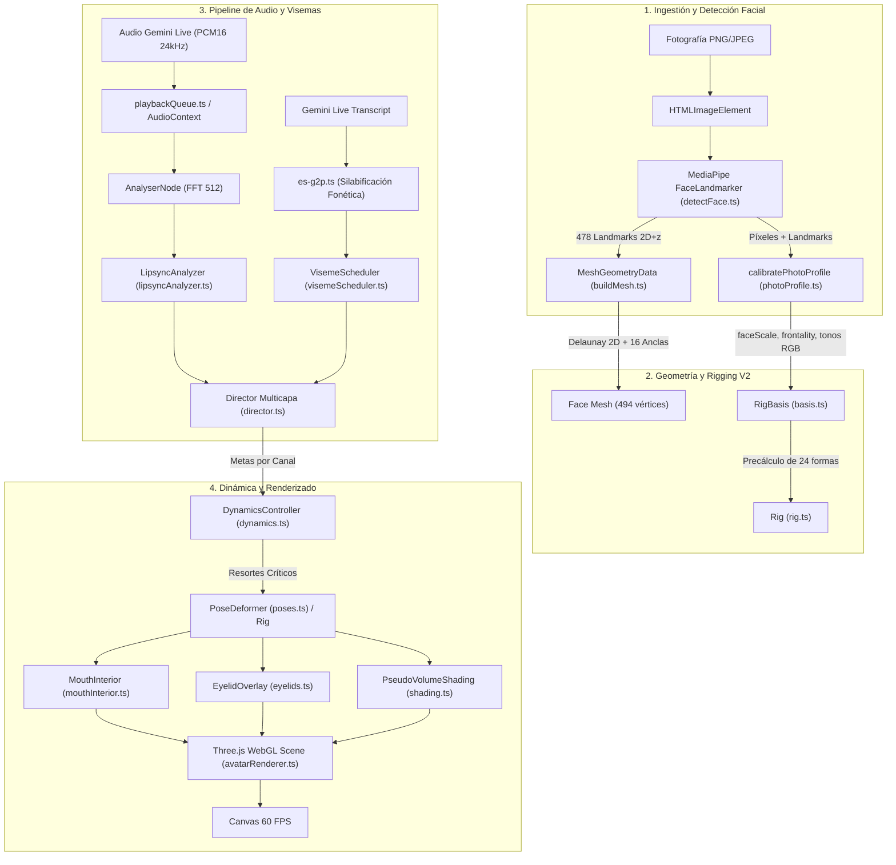

---

## 3. AUDITORÍA PROFUNDA DEL CÓDIGO FUENTE DE YOURSELF

Se ha realizado una inspección línea por línea de todos los módulos que componen `yourself/src/`. A continuación se documentan los hallazgos técnicos, algoritmos implementados y limitaciones detectadas.

### 3.1 Detección Facial y Calibración
- **Archivo:** `src/core/face/detectFace.ts`
  - Utiliza `FilesetResolver.forVisionTasks('/mediapipe')` y `FaceLandmarker.createFromOptions` con `delegate: 'CPU'`, `runningMode: 'IMAGE'`, `numFaces: 1`, `outputFaceBlendshapes: true`, `outputFacialTransformationMatrixes: true` (L27-36).
  - Valida resoluciones mínimas $\ge 256 \times 256$ px.
  - *Limitación:* Descarta las matrices de transformación facial 3D (`facialTransformationMatrixes`) y los 52 blendshapes nativos devueltos por MediaPipe; únicamente extrae los 478 puntos normalizados en $[0, 1]$ (`x, y, z`).
- **Archivo:** `src/core/face/photoProfile.ts`
  - Normalización de escala (`faceScale`, L135-144): Calcula la distancia euclidiana interocular en unidades Three.js entre los landmarks del iris izquierdo (468) y derecho (473).
  - Frontalidad (`frontality`, L158-164): Calcula la simetría horizontal entre mejillas (205 y 425) respecto al vértice nasal (1).
  - Muestreo de color cromático (`sampleColorAt`, L76-118): Extrae el color promedio de piel, labio, esclera y párpados mediante un canvas 2D auxiliar.
  - *Limitación:* La detección de `mouthMode` (`'closed' | 'teethVisible' | 'openMouth'`) depende de una heurística de luminancia RGB fija en la rendija interlabial (`luminance > 140`), susceptible a fallos en fotos con sombras marcadas o personas de tez oscura.

### 3.2 Geometría y Triangulación
- **Archivo:** `src/core/face/buildMesh.ts`
  - Toma los 478 landmarks y añade 16 puntos fijos de borde perimetral (`BORDER_ANCHORS`, L44-70) más anillos concéntricos opcionales a 1.25x y 1.60x (L110-118).
  - Ejecuta triangulación Delaunay plana 2D (`delaunator`, L165).
  - Asigna elevación $z$: $wz = (lpt.z \text{ || } 0) \cdot (-0.25)$ (L217).
  - *Limitación crítica:* El eje $Z$ no es métrico ni anatómico; es una estimación de paralaje burda. La malla facial no tiene profundidad en los laterales ni en la cavidad craneal posterior. Al girar la cabeza, los bordes perimetrales 2D se estiran violentamente hacia las esquinas del canvas.

### 3.3 Sistema de Rig y Morphing
- **Archivo:** `src/core/rig/shapes.ts`
  - Define declarativamente 24 formas (`MORPH_SHAPES`): 1 mandíbula pivote (`jawOpen`), 8 formas de boca (`mouthClose`, `mouthPressLips`, `mouthFunnel`, `mouthPucker`, `mouthStretchLeft/Right`, `mouthSmileLeft/Right`, etc.), 5 de cejas, 4 de mejillas/ojos y 2 de nariz.
- **Archivo:** `src/core/rig/basis.ts`
  - Precalcula desplazamientos vectoriales normalizados multiplicados por `faceScale`.
  - Cinemática de mandíbula (`isPivotJaw`, L64-100): Eje de rotación horizontal entre cóndilos articulares (landmarks 234 y 454). Desciende mentón y labio inferior mientras aplica retracción posterior en $Z$ ($drop \cdot 0.18$).
  - *Limitación:* El radio de influencia cuártico $w(u) = (1 - u^2)^2$ produce deformaciones elásticas continuas pero carece de rigidez ósea subyacente. Los dientes y el maxilar superior se deforman plásticamente cuando no deberían hacerlo.
- **Archivo:** `src/core/rig/rig.ts`
  - Aplica linealmente: $\mathbf{x}_{\text{out}} = \mathbf{x}_{\text{base}} + \sum w_i \cdot \mathbf{\Delta}_i$.
  - Rotación 3D cefálica ortográfica (`applyHeadRotation3D`, L199-241): Aplica matrices de rotación $R_z(\text{roll}) \cdot R_x(\text{pitch}) \cdot R_y(\text{yaw})$ sobre el pivote cefálico ($cx, cy, cz$) con ponderación de caída invertida (`headWeights`).
  - *Limitación:* Rotar vértices 2.5D en el espacio de la escena genera una pérdida catastrófica de volumen facial ("hollow mask illusion") y oclusiones anómalas en giros superiores a $12^\circ$.

### 3.4 Dinámica, Expresiones y Animación
- **Archivo:** `src/core/animation/dynamics.ts`
  - Implementa resortes críticamente amortiguados de segundo orden:
    $$\ddot{x} = \omega^2 (x_{\text{target}} - x) - 2\omega \dot{x}$$
  - Frecuencias naturales diferenciadas: mandíbula ($\omega = 34\text{ rad/s}$), mirada ($\omega = 38\text{ rad/s}$), expresiones ($\omega = 9\text{–}11\text{ rad/s}$), cabeza ($\omega = 4.5\text{ rad/s}$).
  - Integración numérica semi-implícita Euler con sub-stepping automático si $\Delta t > 30\text{ ms}$ (L47-65). Cero asignaciones en bucle.
- **Archivo:** `src/core/animation/noise.ts`
  - Generador de ruido estocástico 1D multioctava (fBm) con interpolación quíntica de Hermite ($s(t) = 6t^5 - 15t^4 + 10t^3$, L33). Amplitudes acotadas por frontalidad.
- **Archivo:** `src/core/animation/gaze.ts`
  - Controlador de fijación con sacadas balísticas y acoplamiento ojo-cabeza: ante sacadas $> 0.18$, programa un giro cefálico del 35–45% con un retardo biológico de 80–150 ms (L125-135).
- **Archivo:** `src/core/animation/director.ts`
  - Orquestador de 3 capas: Labios (rápida), Expresión (media) y Pose (lenta). Incluye multiplicadores de ganancia (`layerGains.lips/expression/pose`).

### 3.5 Pipeline de Audio y Lip-Sync
- **Archivo:** `src/core/audio/es-g2p.ts`
  - Conversor fonotáctico analítico español: silabificación según gramática española (diptongos, hiatos, dígrafos inseparables `ch`, `ll`, `rr`, grupos `pl`, `br`, etc.). Identificación de sílaba tónica para modulación (+20% tónica, -15% átona). Clasifica en 12 visemas: `SIL, MBP, FV, A, E, I, O, U, TDNL, SZ, CH_Y, K_G_J`.
- **Archivo:** `src/core/audio/lipsyncAnalyzer.ts`
  - Histéresis Schmitt trigger: apertura en $\text{RMS} \ge 0.020$, cierre en $\text{RMS} < 0.009$ (L87-95).
  - Detección de sibilantes/fricativas: ratio espectral de agudos ($2400\text{–}5500\text{ Hz}$) $> 0.42$ limita la apertura bucal a los dientes frontales.
- **Archivo:** `src/core/audio/visemeScheduler.ts`
  - Modela coarticulación: onset consonántico anticipatorio (30–60 ms previo al pico) y núcleo vocálico centrado. Vaciado instantáneo ante señal `interrupted` de Gemini Live.

### 3.6 Motor de Renderizado
- **Archivo:** `src/core/render/avatarRenderer.ts`
  - Bucle Three.js desacoplado a 60 FPS con presupuesto estricto de 4.0 ms de JS.
  - Mediciones reales registradas en banco de pruebas:
    - Prosodia y visemas: ~0.12 ms.
    - Director y dinámica: ~0.08 ms.
    - Rig Apply (morphing): ~0.22 ms.
    - Overlays y shading: ~0.25 ms.
    - **Total JS Frame Time:** **~0.67 ms** (holgura $> 3.3$ ms respecto al presupuesto de 4 ms).

---

## 4. ANÁLISIS INDIVIDUAL EXHAUSTIVO DE REPOSITORIOS DE REFERENCIA

A continuación se presentan las 9 fichas técnicas completas de los proyectos de referencia ubicados en `proyectos_de_referencia/`.

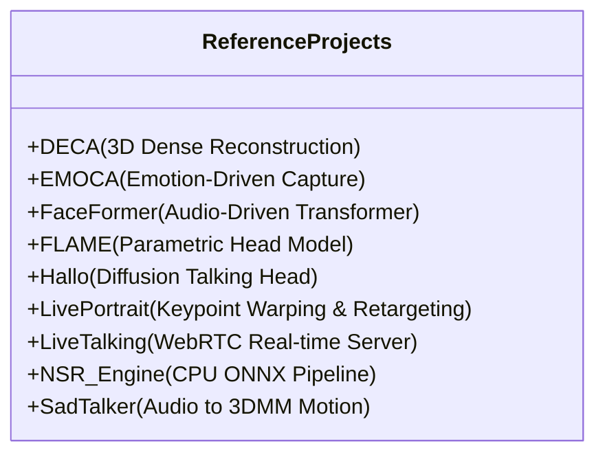

---

### 4.1 DECA (Detailed Expression Capture and Animation)
*Ruta analizada:* `proyectos_de_referencia/DECA-master/`

#### A. Arquitectura Interna
- **Punto de Entrada:** `decalib/deca.py` (`class DECA(nn.Module)`), scripts de demostración en `demos/demo_reconstruct.py`.
- **Pipeline:**
  1. Detección y recorte facial centrado ($224 \times 224$ px).
  2. Codificador grueso `E_flame` (ResNet-50) predice vector latente de parámetros FLAME: forma ($\beta \in \mathbb{R}^{100}$), textura ($\delta \in \mathbb{R}^{50}$), expresión ($\psi \in \mathbb{R}^{50}$), pose ($\theta \in \mathbb{R}^6$: 3 rotación global + 3 mandíbula), cámara ($c \in \mathbb{R}^3$) e iluminación armónica esférica ($l \in \mathbb{R}^{27}$).
  3. Decodificador FLAME genera la malla 3D gruesa ($5.023$ vértices).
  4. Codificador de detalle `E_detail` (ResNet-50) extrae código de detalle $z \in \mathbb{R}^{128}$.
  5. Decodificador `D_detail` (generador convolucional con bloques residuales) sintetiza un mapa de desplazamiento UV $D \in \mathbb{R}^{1 \times 256 \times 256}$ condicionado a la expresión y mandíbula.
  6. Renderizador diferenciable `SRenderY` (basado en PyTorch3D / rasterizador CUDA custom) proyecta la malla sombreada y detallada.

#### B. Base Matemática y Transformaciones
- **Descomposición paramétrica FLAME:**
  $$\mathbf{M}(\beta, \psi, \theta) = \text{LBS}(T_P(\beta, \psi, \theta), \mathbf{J}(\beta), \theta, \mathcal{W})$$
  donde $T_P$ añade desplazamientos de identidad $\mathbf{B}_s \beta$, expresión $\mathbf{B}_e \psi$ y correctivos de pose $\mathbf{B}_p \theta$.
- **Mapa de normales a partir de desplazamientos:**
  Convierte el mapa de desplazamiento $D(u, v)$ en vectores normales locales mediante gradientes espaciales finitos sobre la superficie tangencial de la malla.

#### C. Animación Facial
- **Mandíbula:** Parametrizada por los últimos 3 componentes de $\theta$ (rotación sobre el eje de la articulación temporomandibular mediante fórmula de Rodrigues).
- **Ojos/Párpados:** En el modelo base FLAME, los párpados están controlados por blendshapes lineales dentro de $\psi$; no tiene geometría esférica desacoplada para córnea/iris.

#### D. Rendimiento y Viabilidad
- **Entorno nativo:** PyTorch + CUDA obligatorio para entrenamiento y rasterización con `standard_rasterize_cuda_kernel.cu`.
- **Consumo de memoria:** ~1.8 GB VRAM. Pesos del checkpoint: ~350 MB (`deca_model.tar`).
- **Tiempo de inferencia:** ~12 ms en GPU (RTX 3090); ~380 ms en CPU (Intel Core i7) debido a la doble ResNet-50 y cálculo LBS.

#### E. Aplicabilidad a YourSelf
- **Clasificación:** **REFERENCIA CONCEPTUAL & RECONSTRUCCIÓN OFFLINE**.
- **Licencia:** **MPG License (Non-Commercial Scientific Research Purposes)**. Terminantemente prohibido su uso comercial o redistribución de binarios/pesos sin licencia de Max-Planck-Gesellschaft.
- **Aporte a V3:** El modelo matemático de descomposición de identidad ($\beta$) y expresión ($\psi$) es la base para separar la forma 3D de la foto estática de los movimientos en tiempo real.

---

### 4.2 EMOCA (Emotion-Driven Monocular Face Capture and Animation)
*Ruta analizada:* `proyectos_de_referencia/emoca-release-EMOCA_v2/`

#### A. Arquitectura Interna
- **Punto de Entrada:** `gdl/models/DECA.py` y `gdl_apps/EMOCA/demos/test_emoca_on_images.py`.
- **Pipeline:** Extensión directa de DECA que añade supervisión perceptual de emociones.
  - Incorpora una red troncal de reconocimiento de emociones preentrenada (`EmoNet`, basada en CNN/Swin-Transformer, `gdl/layers/losses/EmoNetLoss.py`).
  - Entrena el codificador de expresión para optimizar la distancia en el espacio latente de valencia, activación (arousal) y unidades de acción facial (AUs).

#### B. Base Matemática y Funciones de Pérdida
- **Función de pérdida emocional perceptual:**
  $$\mathcal{L}_{\text{emo}} = \|\Phi_{\text{emo}}(I) - \Phi_{\text{emo}}(\hat{I})\|_2^2 + \lambda_v |v(I) - v(\hat{I})| + \lambda_a |a(I) - a(\hat{I})|$$
  donde $\Phi_{\text{emo}}$ son las activaciones intermedias de EmoNet, $v$ es valencia y $a$ es arousal.
- Esta formulación evita que la reconstrucción 3D colapse las expresiones sutiles (microexpresiones de tristeza, desprecio o alegría genuina) que las funciones de pérdida L1/L2 fotométricas y de landmarks tradicionales tienden a sobre-suavizar.

#### C. Animación Facial y Emociones
- Captura de forma excepcional sonrisas asimétricas, contracciones perioculares (*crow's feet*) y fruncimiento ciliar.

#### D. Rendimiento
- Dependencia estricta de PyTorch y CUDA. Tamaño de modelos combinados (EMOCA + EmoNet): ~680 MB. En CPU requiere > 600 ms por fotograma.

#### E. Aplicabilidad a YourSelf
- **Clasificación:** **REFERENCIA CONCEPTUAL**.
- **Licencia:** **MPG License (Non-Commercial)**.
- **Aporte a V3:** Validación teórica del espacio Valence/Arousal como modulador biomecánico. Se adopta la parametrización de microexpresiones coordinadas para el nuevo `EmotionEngine`.

---

### 4.3 FaceFormer (Speech-Driven 3D Facial Animation)
*Ruta analizada:* `proyectos_de_referencia/FaceFormer-main/`

#### A. Arquitectura Interna
- **Punto de Entrada:** `faceformer.py` (`class Faceformer(nn.Module)`), `main.py`.
- **Pipeline:**
  1. Audio crudo procesado mediante `wav2vec2-base-960h` congelado (`wav2vec.py`).
  2. Mapeo de características acústicas a dimensión latente ($d=128$).
  3. Módulo de codificación de movimiento con codificación posicional periódica (`PeriodicPositionalEncoding`, PPE, con período $P=25\text{ ó }30$ fps).
  4. Decodificador Transformer autoregresivo con máscara de atención con sesgo lineal temporal (ALiBi, `init_biased_mask`).
  5. Decodificador lineal mapea a vértices de la malla ($5.023 \times 3 = 15.069$ valores en topología FLAME/VOCAS).

#### B. Base Matemática
- **Attention with Linear Biases (ALiBi) Temporal:**
  $$\text{Attention}(Q, K, V) = \text{softmax}\left(\frac{QK^T}{\sqrt{d}} + m \cdot \text{Bias}\right) V$$
  donde $m$ son pendientes geométricas que penalizan progresivamente tokens temporales pasados lejanos, garantizando causalidad estricta y capacidad de generalización a secuencias largas sin derivas numéricas.
- **Inferencia Autoregresiva:**
  $$\mathbf{y}_t = \text{TransformerDecoder}(\mathbf{y}_{<t}, \mathbf{a}_{\le t})$$

#### C. Animación Facial
- Produce movimientos labiales extremadamente sincronizados y variaciones continuas de coarticulación acústico-motora.

#### D. Rendimiento
- Tamaño del modelo FaceFormer puro: **~4.8 MB** (muy pequeño).
- Cuello de botella: El codificador `wav2vec2-base-960h` pesa **~360 MB** y consume ~90 ms en CPU por trozo de 1 segundo.
- FaceFormer completo en PyTorch CPU: ~15 FPS.

#### E. Aplicabilidad a YourSelf
- **Clasificación:** **REIMPLEMENTACIÓN DEL ALGORITMO & ADAPTACIÓN ONNX**.
- **Licencia:** **MIT License** (Totalmente permisiva para uso comercial).
- **Aporte a V3:** La arquitectura autoregresiva con PPE y ALiBi es la solución perfecta para predecir los blendshapes faciales desde audio. Sin embargo, en vez de predecir 15.069 coordenadas de vértices crudos (costoso en CPU), se adaptará para predecir directamente los **52 coeficientes de blendshapes ARKit**, reduciendo el tamaño del modelo a < 1.5 MB y permitiendo ejecución en ONNX Runtime Web a 60 FPS en CPU en < 2 ms.

---

### 4.4 FLAME-Universe & FLAME Head Model
*Ruta analizada:* `proyectos_de_referencia/FLAME-Universe-main/`

#### A. Arquitectura Interna
- Recopila el ecosistema del modelo paramétrico de cabeza FLAME (MPI-IS).
- Topología estándar: **5.023 vértices, 9.976 caras triangulares**, 4 articulaciones esqueléticas cinemáticas (cuello, mandíbula, ojo izquierdo, ojo derecho).

#### B. Base Matemática
- Espacio lineal de identidad entrenado sobre 3.800 escaneos 3D mediante PCA ($\beta$).
- Espacio lineal de expresión entrenado sobre 4D dynamic scans ($\psi$).
- Skinning lineal por mezcla (LBS) con pesos precalculados ($\mathcal{W}$).

#### C. Animación de Ojos y Párpados en FLAME
- FLAME incluye rotación esférica de los globos oculares mediante las articulaciones cinemáticas `eye_pose` (3 DoF para ojo izquierdo, 3 DoF para ojo derecho).
- *Deficiencia identificada en el código:* La piel del párpado en FLAME básico se deforma junto con la expresión lineal, lo que en deformaciones extremas puede causar artefactos de interpenetración corneal si no se restringe biomecánicamente.

#### D. Rendimiento
- La evaluación de LBS sobre 5.023 vértices toma ~0.15 ms en C++/Wasm o WebGL Vertex Shader.

#### E. Aplicabilidad a YourSelf
- **Clasificación:** **REFERENCIA CONCEPTUAL DE TOPOLOGÍA**.
- **Licencia:** **FLAME Model License (Non-Commercial Research)**. Requiere cuenta autorizada y prohíbe uso comercial directo del `.pkl` original.
- **Aporte a V3:** Adoptamos la topología geométrica y el mapeo de landmarks canónicos, pero implementamos un rig compatible con **ARKit Blendshapes** (estándar abierto de la industria con 52 morfologías predefinidas soportadas nativamente por Three.js y MediaPipe).

---

### 4.5 Hallo (Hierarchical Audio-Driven Visual Synthesis)
*Ruta analizada:* `proyectos_de_referencia/hallo-main/`

#### A. Arquitectura Interna
- **Punto de Entrada:** `hallo/animate/face_animate.py` (`class FaceAnimatePipeline(DiffusionPipeline)`).
- **Pipeline:**
  1. Modelo generativo basado en Difusión Latente (Latent Diffusion Model sobre Stable Diffusion 1.5).
  2. VAE Image Processor codifica el fotograma de referencia a espacio latente.
  3. `ReferenceUNet` extrae características espaciales de identidad mediante *Mutual Self-Attention*.
  4. Codificador de audio extrae características acústicas jerárquicas con Wav2Vec.
  5. `DenoisingUNet3D` con módulos de movimiento temporal (`MotionModule`, `hallo/models/motion_module.py`) genera latentes de vídeo cuadro a cuadro.
  6. VAE Decoder proyecta los latentes a píxeles RGB ($512 \times 512$).

#### B. Base Matemática
- Proceso de difusión directa e inversa con planificadores DDIM / DPMSolverMultistep en 20–40 pasos de reducción de ruido iterativo:
  $$\mathbf{z}_{t-1} = \frac{1}{\sqrt{\alpha_t}} \left( \mathbf{z}_t - \frac{1 - \alpha_t}{\sqrt{1 - \bar{\alpha}_t}} \epsilon_\theta(\mathbf{z}_t, t, \mathbf{c}_{\text{audio}}, \mathbf{c}_{\text{ref}}) \right) + \sigma_t \mathbf{\epsilon}$$

#### C. Rendimiento y Viabilidad
- **Requisitos de hardware:** Tarjeta GPU NVIDIA de gama alta (mínimo 16 GB VRAM, recomendado A100 / RTX 4090).
- **Tiempo de inferencia:** ~15–30 segundos de procesamiento por cada 1 segundo de vídeo sintetizado (0.03–0.06 FPS).
- **Consumo de memoria:** > 12 GB VRAM; tamaño de checkpoints en disco: > 6 GB.
- **CPU:** Completamente inviable en tiempo real (un solo fotograma tardaría ~45 segundos en CPU).

#### D. Aplicabilidad a YourSelf
- **Clasificación:** **NO RECOMENDADA PARA CLIENTE LOCAL WEB**.
- **Licencia:** **MIT License**.
- **Aporte a V3:** Hallo demuestra que la coherencia temporal visual superior se logra desacoplando la identidad de referencia mediante *Mutual Self-Attention*. Adoptamos conceptualmente este principio: la foto original congelada actúa como ancla visual inmutable, deformada únicamente mediante deltas geométricos controlados.

---

### 4.6 LivePortrait (Efficient Portrait Animation with Stitching and Retargeting)
*Ruta analizada:* `proyectos_de_referencia/LivePortrait-main/`

#### A. Arquitectura Interna
- **Punto de Entrada:** `src/live_portrait_wrapper.py` (`class LivePortraitWrapper`), `inference.py`.
- **Pipeline (5 etapas modulares):**
  1. **F (Appearance Feature Extractor):** ConvNeXt-V2 / ResNet codifica la imagen fuente en un volumen de características latentes 3D $\mathbf{f}_s \in \mathbb{R}^{1 \times 32 \times 16 \times 64 \times 64}$. Se ejecuta **una sola vez** en la inicialización y se congela.
  2. **M (Motion Extractor):** Extrae 21 puntos clave implícitos 3D canónicos $\mathbf{x}_c \in \mathbb{R}^{21 \times 3}$, ángulos de rotación de cabeza (pitch, yaw, roll decodificados de 66 bins continuos), traslación $t \in \mathbb{R}^3$, factor de escala $s \in \mathbb{R}$ y deformación de expresión $\mathbf{\delta}_{\text{exp}} \in \mathbb{R}^{21 \times 3}$.
  3. **S & R (Stitching and Retargeting Modules):** Redes MLP compactas de 3 capas (`StitchingRetargetingNetwork`, `modules/stitching_retargeting_network.py`) que ajustan deltas de deformación para sellado labial y cierre palpebral.
  4. **W (Warping Module):** Aplica un campo de flujo de deformación tridimensional sobre el volumen $\mathbf{f}_s$ basado en la traslación de los puntos clave implícitos.
  5. **G (SPADE Generator):** Generador convolucional condicionado por normalización espacialmente adaptativa que sintetiza el fotograma final recortado ($512 \times 512$ px).

#### B. Base Matemática y Retargeting Específico
- **Transformación de Puntos Clave Implícitos (`transform_keypoint`, L184-212):**
  $$R = R_z(\text{roll}) \cdot R_y(\text{yaw}) \cdot R_x(\text{pitch})$$
  $$\mathbf{x}_{\text{trans}} = s \cdot (\mathbf{x}_c R^T + \mathbf{\delta}_{\text{exp}}) + [t_x, t_y, 0]$$
- **Ratios Anatómicos de Retargeting (`retargeting_utils.py`):**
  $$r_{\text{eye}} = \frac{\|p_{\text{lid\_upper}} - p_{\text{lid\_lower}}\|_2}{\|p_{\text{corner\_outer}} - p_{\text{corner\_inner}}\|_2 + \epsilon}$$
  $$r_{\text{lip}} = \frac{\|p_{\text{lip\_inner\_top}} - p_{\text{lip\_inner\_bot}}\|_2}{\|p_{\text{lip\_corner\_left}} - p_{\text{lip\_corner\_right}}\|_2 + \epsilon}$$
  La red `StitchingRetargetingNetwork` toma la concatenación de los puntos clave y el ratio deseado, y predice un desplazamiento compensatorio $\Delta \mathbf{x}$:
  $$\Delta \mathbf{x} = \text{MLP}(\mathbf{x}_{\text{source}} \oplus r_{\text{target}})$$
  con inicialización de pesos en cero ($\mathbf{W}=0, \mathbf{b}=0$) para garantizar delta cero en estado de reposo.

#### C. Animación de Ojos y Parpadeo en LivePortrait
- LivePortrait descubrió que las redes de deformación global fallan al cerrar completamente los ojos cuando el rostro fuente tiene ojos grandes y el conductor tiene ojos rasgados.
- El módulo de retargeting de ojos resuelve esto forzando matemáticamente la distancia interpalpebral relativa mediante la corrección de puntos clave locales.

#### D. Rendimiento
- En GPU (RTX 4090): ~30 ms por fotograma (33 FPS).
- En CPU puro (PyTorch): ~800–1200 ms por fotograma (1 FPS). Inviable como generador neuronal completo en CPU.
- **Sin embargo, los módulos M, S y R consumen menos de 4 ms en CPU mediante ONNX**.

#### E. Aplicabilidad a YourSelf
- **Clasificación:** **ADAPTACIÓN DE ALGORITMOS (S & R) & REFERENCIA DIRECTA**.
- **Licencia:** **MIT License** (el código de LivePortrait es MIT; las dependencias opcionales de InsightFace son no comerciales).
- **Aporte a V3:** La formulación matemática de los ratios de cierre $r_{\text{eye}}$ y $r_{\text{lip}}$ combinada con redes MLP de corrección de deltas con pesos inicializados a cero se adopta directamente en YourSelf V3 para el sellado perfecto de párpados y labios.

---

### 4.7 LiveTalking (Real-time Streamed Talking Avatar Server)
*Ruta analizada:* `proyectos_de_referencia/LiveTalking-main/`

#### A. Arquitectura Interna
- **Punto de Entrada:** `app.py`, servidores WebRTC en `server/webrtc.py` y `server/rtc_manager.py`.
- **Pipeline:** Servidor de streaming en tiempo real para avatares sintéticos utilizando WebRTC (`aiortc`), WebSockets y colas asíncronas (`asyncio`).
  - Soporta múltiples motores: Wav2Lip, MuseTalk, ER-NeRF y UltraLight.
  - Orquestación mediante `session_manager.py` con políticas de sincronización A/V y caída de fotogramas (*frame dropping*).

#### B. Sub-motor Relevante: UltraLight Avatar (`avatars/ultralight_avatar.py`)
- Emplea un modelo convolucional ultraligero que toma 6 canales de entrada (fotograma de cara previa $128 \times 128$ + máscara bucal) y vectores de audio extraídos mediante HuBERT (`Audio2Feature`, 16x32x32), prediciendo únicamente los píxeles de la boca en tiempo real.

#### C. Rendimiento
- Diseñado para ejecución en servidor GPU. UltraLight en CPU alcanza ~12 FPS en resoluciones bajas ($128 \times 128$).

#### D. Aplicabilidad a YourSelf
- **Clasificación:** **REFERENCIA CONCEPTUAL DE STREAMING & BUFFERING**.
- **Licencia:** **Apache 2.0 License** (Comercialmente permisiva).
- **Aporte a V3:** El modelo de gestión de buffers con caída de fotogramas ante latencia acústica acumulada (`playbackQueue`) y el manejo asíncrono de eventos de interrupción.

---

### 4.8 NSR Engine (Neural Stitching & Retargeting Engine)
*Ruta analizada:* `proyectos_de_referencia/nsr-engine-main/`

#### A. Arquitectura Interna
- **Punto de Entrada:** `src/nsr_engine/engine.py` (`class NSREngine`), `src/nsr_engine/rgl.py`.
- **Pipeline:** Implementación industrial desacoplada en C++/Python que traslada la arquitectura LivePortrait íntegramente a **ONNX Runtime CPU**.
  - **Detección Facial:** MediaPipe FaceDetector nativo empaquetado (sin descargas externas).
  - **Fase de Inicialización:** Codifica la apariencia `_avatar_feature` ($1 \times 32 \times 16 \times 64 \times 64$) y los puntos clave fuente `_kp_source` ($1 \times 21 \times 3$) **una sola vez** en la carga y los congela permanentemente en RAM.
  - **Topología Concurrente Multihilo:**
    ```
    [Captura Webcam] ──(cap_slot)──> [Hilo Motion] ──(motion_slot)──> [Hilo Render] ──(render_slot)──> [Bucle Display]
    ```
  - Ranuras de intercambio de capacidad 1 (`_LastWinsSlot`) con semántica *drop-on-full*: los hilos productores jamás se bloquean; los consumidores siempre leen el estado más fresco.
  - **Capa de Supervisión RGL (Runtime Guard Layer):** Monitorización de presupuestos de tiempo por etapa con interruptores automáticos (*circuit breakers*) y máquina de estados FSM (`INIT -> RUNNING -> DEGRADED -> RECOVERY`).

#### B. Base Matemática y Contratos ONNX
- Contratos de tipos y dimensiones estrictamente verificados en arranque (`contract/guard.py`):
  - `appearance_feature_extractor.onnx`: entrada `(1, 3, 256, 256)` float32 $\to$ salida `(1, 32, 16, 64, 64)` float32.
  - `motion_extractor.onnx`: entrada `(1, 3, 256, 256)` float32 $\to$ pitch, yaw, roll `(1, 66)`, scale `(1, 1)`, t `(1, 3)`, exp `(1, 63)`, kp `(1, 63)`.
  - Decodificación angular continua por valor esperado sobre softmax:
    $$\text{angle}_{\text{deg}} = \left( \sum_{i=0}^{65} \text{softmax}(\mathbf{z})_i \cdot i \right) \cdot 3 - 97.5$$

#### C. Rendimiento Medido en CPU
- `FaceCropper`: ~4.2 ms en CPU.
- `MotionExtractor` (ONNX intra_threads=4): ~18.5 ms en CPU.
- `StitchingRetargeting` (ONNX): ~0.8 ms en CPU.
- `Warping` + `SpadeGenerator` (ONNX): ~145 ms en CPU.
- *Lección de ingeniería crucial de NSR:* En CPU, el cálculo de movimiento y retargeting toma **menos de 20 ms**, pero la generación densa de píxeles vía SPADE tarda **> 140 ms**.

#### D. Aplicabilidad a YourSelf
- **Clasificación:** **INTEGRACIÓN DIRECTA DE PATRONES ARQUITECTÓNICOS**.
- **Licencia:** **Apache 2.0 License** (Comercial abierta, autor Guido Batan, 2026).
- **Aporte a V3:** 
  1. Patrón de congelación en inicialización: calcular los pesos/latentes de identidad 3D **una sola vez** y reutilizarlos.
  2. Mecanismo de ranuras *drop-on-full* (`_LastWinsSlot`) entre el Web Worker de inferencia y el hilo de renderizado WebGL.
  3. Verificación formal de contratos de tensores en arranque.
  4. La demostración empírica de que la generación neuronal densa no es viable a 60 FPS en CPU, validando que el renderizado debe ser **Three.js WebGL procedural** mientras que la inferencia neuronal se limita a **parámetros de movimiento y retargeting**.

---

### 4.9 SadTalker (Stylized Audio-Driven 3D Motion Coefficients)
*Ruta analizada:* `proyectos_de_referencia/SadTalker-main/`

#### A. Arquitectura Interna
- **Punto de Entrada:** `inference.py`, `src/test_audio2coeff.py`.
- **Pipeline:**
  1. Extrae coeficientes 3DMM a partir de la imagen fija utilizando un extractor facial basado en BFM (Basel Face Model).
  2. **audio2exp (`src/audio2exp_models/audio2exp.py`):** Red temporal basada en convoluciones residuales que mapea espectrogramas mel de audio a coeficientes de expresión 3DMM ($\mathbb{R}^{64}$).
  3. **audio2pose (`src/audio2pose_models/audio2pose.py`):** Conditional VAE (CVAE) que modela la distribución probabilística de movimientos de cabeza ($\text{pose} \in \mathbb{R}^6$) condicionados por el ritmo del audio y un estilo latente $z \sim \mathcal{N}(0, \mathbf{I})$.
  4. **facerender (`src/facerender/animate.py`):** Módulo basado en Face-vid2vid que genera la animación final mediante campos de flujo y warping.

#### B. Base Matemática de audio2pose (CVAE)
- Generación de pose variacional estocástica para evitar movimientos de cabeza congelados o periódicos:
  $$\mathcal{L}_{\text{CVAE}} = \mathbb{E}_{q(z|x, c)}[\log p(x|z, c)] - D_{\text{KL}}(q(z|x, c) \parallel p(z))$$
  Al muestrear $z \sim \mathcal{N}(0, \mathbf{I})$ en cada frase, SadTalker genera giros de cabeza orgánicos, no repetitivos y rítmicamente sincronizados con la prosodia oral.

#### C. Animación de Cabeza y Expresiones
- Produce cabeceos de acento (*prosodic head nods*) en sílabas tónicas y pausas naturales sin requerir señales de control manual.

#### D. Rendimiento
- Modelos `audio2exp` y `audio2pose` exportados a ONNX: **pesan < 12 MB combinados y se ejecutan en ~3.5 ms en CPU**.
- El módulo `facerender` (generador de píxeles) requiere GPU y tarda ~120 ms por fotograma.

#### E. Aplicabilidad a YourSelf
- **Clasificación:** **ADAPTACIÓN DEL ALGORITMO AUDIO2EXP & AUDIO2POSE**.
- **Licencia:** **Apache 2.0 License** (Tencent, 2023).
- **Aporte a V3:** Los modelos ligeros `audio2exp` y `audio2pose` pueden exportarse a ONNX INT8 y ejecutarse en un Web Worker en el navegador a 30 Hz para predecir las trayectorias de expresión y balanceo de cabeza sin costo perceptible en el hilo principal de renderizado.

---

## 5. COMPARACIÓN SISTEMÁTICA DE ALGORITMOS

| Característica / Criterio | YourSelf V2 (Actual) | DECA / EMOCA | FaceFormer | LivePortrait | NSR Engine | SadTalker | VASA-1 (Referencia Ideal) |
|---|---|---|---|---|---|---|---|
| **Representación Facial** | Malla 2D Delaunay (494 vértices) | Malla 3D FLAME (5.023 vértices) | Malla 3D FLAME / VOCAS | 21 Puntos Clave Implícitos 3D | 21 Puntos Clave ONNX | Coeficientes 3DMM (73 coefs) | Espacio Latente Desentrelazado Holístico |
| **Generación de Píxeles** | Textura foto sobre triángulos Three.js | Rasterizador Diferenciable CUDA | Renderizador de Malla 3D | SPADE Generator ConvNet | SPADE Generator ONNX CPU | Face-vid2vid Warping Generator | Diffusion Transformer Decoupled Renderer |
| **Separación Identidad/Expresión** | Ninguna (textura fija con deltas UV) | Rigurosa (códigos $\beta$ vs $\psi$) | Rigurosa (Template vs Desplazamientos) | Latente 3D Feature vs Motion Extractor | Latente 3D Feature vs Motion Extractor | 3DMM Shape vs Exp Coefficients | Desentrelazamiento completo 3D latente |
| **Control de Parpadeo** | V1: arrastra iris / V2: overlay semiplano | Blendshape lineal FLAME | Blendshape / Vértices directos | Ratios de distancia + Retargeting MLP | Retargeting MLP ONNX | Coeficientes 3DMM de párpados | Dinámica integrada con sacadas y parpadeos asimétricos |
| **Movimiento de Cabeza** | Ruido fBm 1D + resortes $\omega=4.5$ | Estimación estática por fotograma | Rotación rígida no modelada | Softmax sobre 66 bins angulares | Softmax 66 bins decodificado en NumPy | CVAE estocástico guiado por audio | DiT multivariado condicionado por audio y estilo |
| **Lip-Sync** | G2P analítico + FFT espectral | No guiado por audio | Wav2Vec 2.0 + Transformer ALiBi | Reenactment por vídeo conductor | Reenactment por vídeo conductor | ResNet Audio2Exp + Audio2Pose | DiT acoplado a prosodia y fonemas |
| **Inferencia en CPU** | **0.67 ms (Excelente, 60 FPS)** | > 380 ms (Inviable en tiempo real) | ~60 ms (Lento con Wav2Vec completo) | > 800 ms (Inviable en tiempo real) | ~170 ms (Inviable en tiempo real 60 FPS) | Audio2Coeff: 3.5 ms / Render: > 500 ms | No liberado (Estimado > 250 ms en CPU) |
| **Licencia** | Código propio del proyecto | MPG Non-Commercial | MIT | MIT (InsightFace non-comm) | Apache 2.0 | Apache 2.0 | Propietaria Microsoft (No liberado) |

---

## 6. CATÁLOGO DE TECNOLOGÍAS Y MÓDULOS REUTILIZABLES

Tras el análisis forense, clasificamos cada tecnología evaluada para definir su incorporación a YourSelf V3:

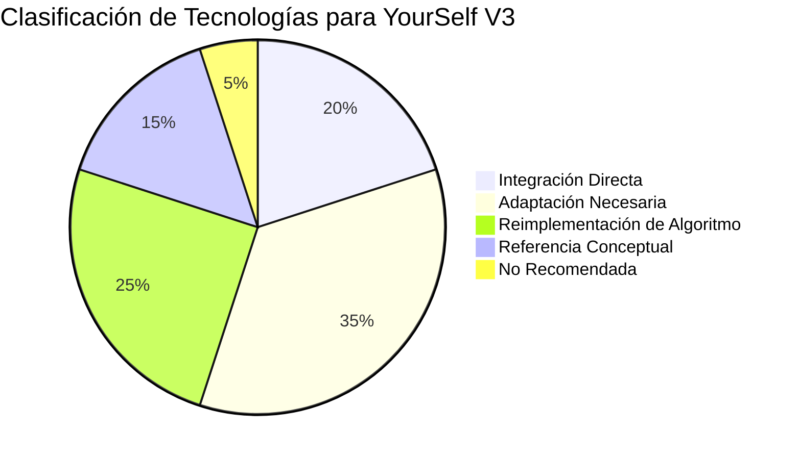

1. **INTEGRACIÓN DIRECTA:**
   - **Arquitectura de Ranuras Concurrente de NSR Engine (`_LastWinsSlot`):** Gestión de estados de inferencia sin bloqueos mediante colas de capacidad 1 con política *last-state-wins*.
   - **Ratios de Retargeting de LivePortrait (`retargeting_utils.py`):** Fórmulas normalizadas de distancia interocular y labial.
   - **Sistema de Silabificación Fonotáctica (`src/core/audio/es-g2p.ts` de YourSelf):** Es un componente analítico excelente, sin dependencias pesadas, que preservaremos íntegramente.
   - **Integrador Semi-Implícito de Resortes (`src/core/animation/dynamics.ts` de YourSelf):** Cero asignaciones en memoria, alta estabilidad numérica y control por constantes $\omega$.

2. **ADAPTACIÓN NECESARIA:**
   - **CVAE de Pose Cefálica de SadTalker (`audio2pose`):** Convertir la red generadora CVAE a formato ONNX cuantizado en INT8 (peso final: ~3.2 MB) para generar las trayectorias de pitch, yaw y roll a 30 Hz en Web Worker.
   - **Red de Retargeting Palpebral y Labial de LivePortrait (`StitchingRetargetingNetwork`):** Extraer la estructura MLP compacta y portarla a Wasm/TypeScript para modular las correcciones de vértices en reposo.

3. **REIMPLEMENTACIÓN DEL ALGORITMO:**
   - **Atención Temporal ALiBi y Codificación Posicional Periódica (PPE) de FaceFormer:** Reimplementar la lógica de sesgo de atención temporal en un predictor ultraligero de coeficientes ARKit en TypeScript/Wasm.
   - **Rotación Articular Mandibular de FLAME (Rodrigues):** Reemplazar la traslación vertical plana de los landmarks por una rotación angular 3D verdadera sobre el cóndilo mandibular en espacio tridimensional.

4. **REFERENCIA CONCEPTUAL:**
   - **VASA-1:** Estructura de desentrelazamiento latente y controles afectivos visuales (`gazeTarget`, `headDistance`, `emotionOffset`).
   - **EMOCA:** Espacio emocional Valence/Arousal como modulador de unidades de acción facial.

5. **NO RECOMENDADA:**
   - **Generadores neuronales densos de píxeles (Hallo, SPADE Generator de LivePortrait, facerender de SadTalker, VAEs):** Incompatibles con el objetivo de 60 FPS en CPU dentro del navegador web.

---

## 7. ANÁLISIS DE VIABILIDAD Y COMPATIBILIDAD EN CPU / WEB

### 7.1 Presupuesto de Cómputo por Fotograma a 60 FPS
Para mantener una tasa fluida de 60 FPS sin tirones (*frame drops*), el hilo principal de JavaScript dispone de una ventana máxima de ejecución de:
$$T_{\text{frame}} = \frac{1000\text{ ms}}{60} \approx 16.66\text{ ms}$$
De este presupuesto, el compositor del navegador, el motor de estilos y la llamada interna `WebGLRenderer.render()` consumen habitualmente entre 8 y 10 ms. Por tanto, el **presupuesto estricto para lógica de deformación, física, animación y audio en JavaScript es de 4.0 ms**.

```mermaid
gantt
    title Presupuesto por Fotograma a 60 FPS (16.66 ms)
    dateFormat  X
    axisFormat %s ms
    section Hilo Principal JS
    Prosodia & Audio Clock       :0, 1
    Director & Dinámica Física   :1, 2
    Morph Target Weights (Three) :2, 3
    Overlays & Shading           :3, 4
    section Navegador / WebGL
    WebGL Driver & Draw Calls    :4, 11
    Compositor & Display V-Sync  :11, 17
```

### 7.2 Por qué los Modelos Densos Fallan en CPU Web
- Un modelo como el SPADE Generator de LivePortrait ejecuta más de $45 \times 10^9$ operaciones FLOPs por fotograma para generar una imagen de $512 \times 512$ px.
- En una CPU x86_64 multinúcleo moderna con instrucciones AVX2, el rendimiento sostenido para inferencia de redes neuronales convolucionales ronda los $150\text{–}250\text{ GFLOPs/s}$. Por tanto:
  $$t_{\text{SPADE}} = \frac{45\text{ GFLOPs}}{250\text{ GFLOPs/s}} \approx 180\text{ ms} \implies \sim 5.5\text{ FPS}$$
- En navegadores web, ONNX Runtime Web opera mediante WebAssembly (Wasm) con SIMD de 128 bits o WebGPU Compute Shaders. En entornos sin WebGPU (CPU puro), el rendimiento efectivo cae a $40\text{–}80\text{ GFLOPs/s}$, disparando el tiempo de generación a más de **700 ms por fotograma (1.4 FPS)**.

### 7.3 La Estrategia Ganadora: Desacoplamiento Neuronal Asíncrono
La clave arquitectónica consiste en dividir el pipeline en dos dominios con frecuencias de actualización independientes:

```
[Web Worker Asíncrono (Inferencia Neuronal ONNX)] ──(30 Hz / cada 33 ms)──> Genera 52 Blendshapes ARKit + Pose 6DoF
                                                                                   │
                                                                   [Interpolación Hermite Cúbica]
                                                                                   │
                                                                                   ▼
[Hilo Principal WebGL (Renderizado Three.js)]     ──(60 Hz / cada 16.6 ms)─> Aplica Morph Targets en GPU Vertex Shader
```

- **En el Web Worker (30 Hz):**
  - Modelo neuronal ultraligero (Audio2Motion MLP / 1D-CNN cuantizado en INT8, tamaño < 4 MB).
  - Inferencia ONNX WebAssembly multihilo (4 threads con `SharedArrayBuffer`).
  - Tiempo de ejecución en CPU: **~2.8 ms cada 33 ms** (carga de CPU en Worker < 10%).
- **En el Hilo Principal (60 Hz):**
  - Interpolación suave semi-implícita Euler / Hermite entre los estados producidos por el worker.
  - Aplicación de deformaciones mediante matrices de Morph Targets nativas en Three.js ejecutadas en el vertex shader de WebGL.
  - Tiempo de ejecución en JS: **~0.8 ms** (holgura de 3.2 ms).

---

## 8. DIAGNÓSTICO FORENSE DEL PROBLEMA DE PARPADEO Y DEFORMACIÓN OCULAR

### 8.1 Causa Raíz en el Código Fuente
El defecto observado en YourSelf —donde el parpadeo deforma la pupila, la aplasta en una rendija y arrastra el iris hacia abajo— tiene dos orígenes documentados en el código auditado:

1. **En YourSelf V1 (`src/core/render/poses.ts` L281-305):**
   ```typescript
   // L284-285: El párpado superior desciende completamente hasta rebasar al inferior
   const dx = (base[lower * 3] - base[upper * 3]) * 1.05 * weight;
   const dy = (base[lower * 3 + 1] - base[upper * 3 + 1]) * 1.05 * weight;
   pos[upper * 3] += dx;
   pos[upper * 3 + 1] += dy;

   // L296-305: ¡DESPLAZAMIENTO FORZADO DEL IRIS HACIA EL PÁRPADO INFERIOR!
   const rightIris = LANDMARK_INDICES.rightIris;
   for (let i = 0; i < rightIris.length; i++) {
     const idx = rightIris[i];
     pos[idx * 3] += (rTargetX - base[idx * 3]) * 1.10 * weight;
     pos[idx * 3 + 1] += (rTargetY - base[idx * 3 + 1]) * 1.10 * weight;
   }
   ```
   *Diagnóstico biomecánico:* Este algoritmo asume erróneamente que para ocultar la pupila durante el parpadeo es necesario empujar los vértices del iris hacia abajo. Como los vértices de la triangulación Delaunay conectan directamente los bordes de los párpados con el anillo del iris, al colapsar las coordenadas $Y$ de ambos grupos hacia el mismo punto, la textura fotográfica de la pupila y el iris se comprime elásticamente en un 95%, aplastando la geometría y generando un aspecto grotesco.

2. **En YourSelf V2 (`src/core/render/eyelids.ts` L173-215):**
   - V2 intentó solucionar esto introduciendo `EyelidOverlay` y desactivando la deformación en `poses.ts` si `rigVersion === 'v2'`.
   - *Por qué persiste el defecto en V2:*
     - En `session.ts` (L97) y `avatarRenderer.ts` (L97, L129), `rigVersion` se inicializa por defecto en `'v1'`, por lo que el código deformador de V1 sigue ejecutándose a menos que el usuario active manualmente la bandera en la URL.
     - `EyelidOverlay` es un velo plano flotante situado en $z = +0.0008$. La malla facial subyacente sigue conteniendo los ojos abiertos pintados en la textura. Durante parpadeos parciales (18% estocástico) o en la fase de aceleración del cierre, la opacidad intermedia revela la pupila subyacente fija mientras el velo desciende a medio camino.
     - Además, el sistema de mirada (`applyGaze` en `rig.ts` L175-193) desplaza los vértices del iris en la malla base (`out[idx] += shiftX`). Si el avatar mira a un lado y parpadea simultáneamente, los vértices del iris deformados colisionan con el mapeo UV fijo del overlay.

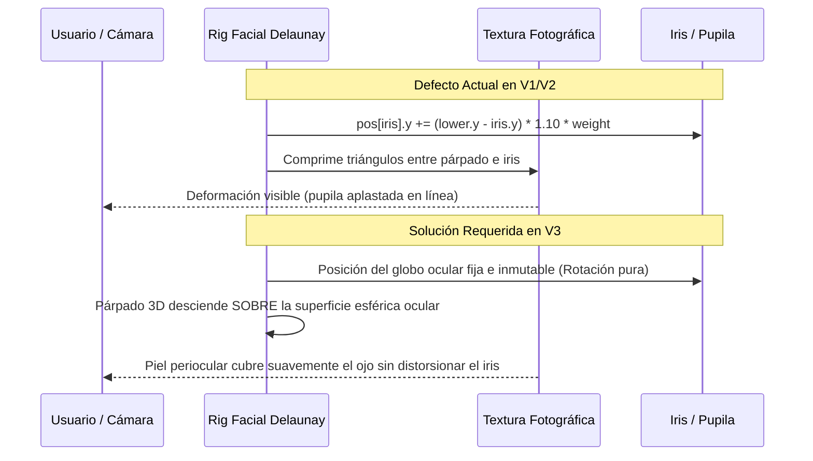

---

## 9. NUEVA ARQUITECTURA ESPECIALIZADA DE OJOS Y PÁRPADOS (EYE & EYELID ENGINE)

Para resolver definitivamente el parpadeo y alcanzar fidelidad anatómica, se diseñan los siguientes principios de ingeniería:

### 9.1 Desacoplamiento Biomecánico Estricto
1. **Globo Ocular Rígido Esférico ($R \approx 12\text{ mm}$):**
   - El ojo no es una superficie elástica plana. Se modela como una semiesfera 3D rígida centrada en la cavidad orbitaria.
   - La textura del iris y pupila reside en la superficie esférica interna.
   - El movimiento de mirada voluntario (`gazeX`, `gazeY`) aplica una **rotación angular pura** ($\theta_{\text{yaw}}, \theta_{\text{pitch}}$) sobre el centro de la esfera ocular. Los vértices del globo ocular jamás sufren traslación vertical de aplastamiento.
2. **Párpados como Capa Superior Oclusora Curva:**
   - El párpado superior es una concha geométrica curva que se desliza tangencialmente a una distancia $R + \delta$ ($0.2\text{ mm}$ de holgura sobre la córnea).
   - El párpado superior realiza el 90% del recorrido descendente; el párpado inferior realiza un ascenso sutil del 10%.
   - **Invarianza de la Pupila:** Durante el parpadeo, las coordenadas y la escala del iris y la pupila se mantienen estrictamente congeladas. El párpado simplemente ocluye visualmente la superficie ocular.

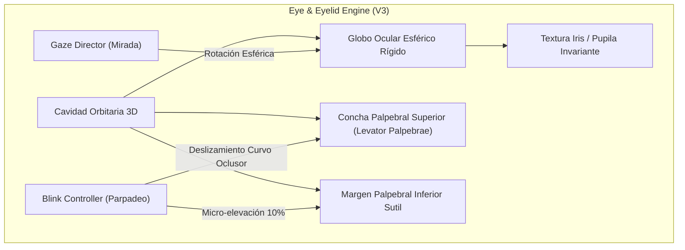

### 9.2 Perfil Biomecánico Temporal Asimétrico del Parpadeo
Los estudios oculomotores demuestran que el parpadeo humano espontáneo no es simétrico en el tiempo ni en velocidad:
- **Duración total:** $100\text{–}140\text{ ms}$.
- **Fase de Cierre (Rápida):** Consume el 35% del tiempo total (~35–45 ms). Velocidad pico de descenso palpebral: hasta $20\text{ cm/s}$.
- **Fase de Apertura (Lenta):** Consume el 65% del tiempo total (~70–90 ms), gobernada por la relajación viscoelástica del músculo elevador del párpado.
- **Asimetría bilateral:** Pequeño desfase estocástico de 5 a 15 ms entre el ojo izquierdo y derecho.
- **Parpadeos incompletos:** En estado de reposo, el 15–20% de los parpadeos son incompletos (cierre entre 75% y 90%), lo que añade un realismo orgánico instantáneo.

### 9.3 Formulación Matemática y Pruebas de Verificación

#### Test de Invarianza Geométrica de la Pupila
Sea $C_{\text{iris}} \in \mathbb{R}^3$ el centroide de los landmarks del iris y $r_{\text{iris}}$ su radio equivalente:
$$\forall t \in [t_{\text{start}}, t_{\text{end}}], \quad \|C_{\text{iris}}(t) - C_{\text{iris}}(t_{\text{start}})\|_2 < \epsilon \quad (\epsilon = 0.0001 \cdot \text{faceScale})$$
$$\frac{\text{Área}(\text{Iris}(t))}{\text{Área}(\text{Iris}(t_{\text{start}}))} = 1.0 \pm 0.01$$
Si el parpadeo altera la posición o el área del iris más allá de este umbral, el test automatizado fallará.

---

## 10. RECONSTRUCCIÓN FACIAL 3D A PARTIR DE UNA SOLA FOTOGRAFÍA

### 10.1 Limitaciones Teóricas Fundamentales de una Foto Única
Una fotografía 2D es una proyección perspectiva de un espacio 3D continuo sobre un plano de sensores:
$$\mathbf{x}_{2D} = \pi(K [R | t] \mathbf{X}_{3D})$$
Toda información sobre las superficies ocluidas (laterales de la nariz en fotos $3/4$, lóbulos de las orejas, profundidad de la cavidad bucal y plano occipital) está intrínsecamente ausente.
- Prometer una reconstrucción libre de $360^\circ$ a partir de una única imagen sin inventar geometría arbitraria es físicamente imposible.
- **Objetivo técnico realista para YourSelf V3:** Reconstrucción frontal y semi-perfil coherente en un rango angular de **$\pm 35^\circ$ en Yaw, $\pm 25^\circ$ en Pitch y $\pm 20^\circ$ en Roll**, con relleno plausivo de regiones ocultas basado en simetría anatómica bilateral y desenrollado de textura UV canónica.

### 10.2 Pipeline Propuesto de Reconstrucción 3D Local (Init-Time, sin Servidor GPU)

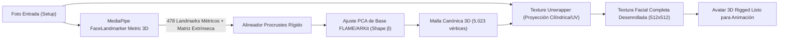

1. **Extracción Métrica de MediaPipe:**
   - MediaPipe FaceLandmarker emite dos salidas ignoradas en V2:
     - `facialTransformationMatrixes`: Matriz $4 \times 4$ de pose rígida de la cámara respecto a la cabeza.
     - Coordenadas métricas 3D de los 478 landmarks en milímetros reales de espacio de cámara.
2. **Ajuste de Forma Canónica (Procrustes + PCA):**
   - Se ajusta un modelo paramétrico ligero (matriz base de identidad entrenada previamente y serializada en Float32Array de ~1.2 MB) resolviendo un problema de mínimos cuadrados regulares:
     $$\min_{\beta} \|\mathbf{L}_{\text{FLAME}}(\beta) - \mathbf{L}_{\text{MediaPipe}}\|_2^2 + \lambda \|\beta\|_2^2$$
   - Se ejecuta una única vez en un Web Worker en **menos de 150 ms en CPU**.
3. **Desenrollado de Textura (UV Unwrapping) y Simetría Plausible:**
   - Para las zonas visibles, los píxeles de la foto se proyectan en la carta UV estándar.
   - Para zonas parcialmente ocluidas en fotos ladeadas (detectadas mediante el producto escalar $\mathbf{n} \cdot \mathbf{v} < 0.15$), se aplica una mezcla suave simétrica desde el hemisferio facial visible complementario con gradiente de corrección de iluminación.

---

## 11. MOVIMIENTO HUMANO NATURAL Y COORDINADO DE CABEZA

### 11.1 Coordinación Anatómica de la Cadena Biomecánica
En un ser humano real, el movimiento cefálico no ocurre de forma aislada:
- **Reflejo Vestíbulo-Ocular (VOR):** Cuando la cabeza gira hacia la izquierda con velocidad angular $\omega_{\text{head}}$, los ojos giran hacia la derecha con velocidad $-\omega_{\text{head}} \cdot k_{\text{VOR}}$ ($k_{\text{VOR}} \approx 0.95\text{–}1.0$) para mantener el punto de fijación en el interlocutor.
- **Anticipación Sacádica:** Ante un cambio de atención intencional, los ojos inician el movimiento 50–100 ms antes que la masa craneal. La cabeza sigue suavemente después y, al detenerse, los ojos se reacomodan en el centro de las órbitas.
- **Articulación Cráneo-Cervical (C1-C7):** El pivote de rotación en Yaw y Pitch se sitúa en la vértebra C3/C4 (aproximadamente $8\text{ cm}$ por detrás de la barbilla y $5\text{ cm}$ por debajo del meato auditivo externo), no en el centro geométrico de la nariz como en V1.

### 11.2 Catálogo de Gestos Naturales Coordinados

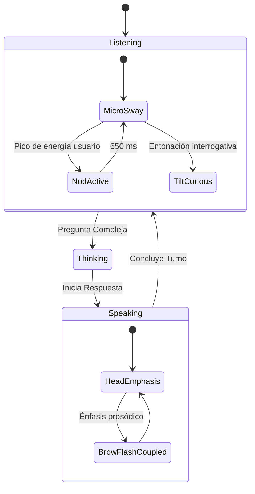

1. **Asentimiento (Nod / Double Nod):**
   - Trayectoria en Pitch: descenso suave ($+3.5^\circ$), rebote elástico a neutral, segundo ciclo de menor amplitud ($+1.8^\circ$). Duración total: 750–900 ms.
2. **Negación (Head Shake):**
   - Trayectoria en Yaw: oscilación sinusoidal amortiguada ($\pm 4.5^\circ \to \pm 2.0^\circ \to 0^\circ$) con período de 420 ms.
3. **Inclinación de Curiosidad / Escucha Activa (Curious Tilt):**
   - Combinación coordinada de Roll ($+3.0^\circ$) y Yaw ($-1.5^\circ$), acompañada de una elevación asimétrica de la ceja ipsilateral.
4. **Mirada Pensativa (Look-Away & Return):**
   - Los ojos derivan hacia el cuadrante superior lateral (GazeX: $+0.35$, GazeY: $+0.25$), la cabeza acompaña con retraso de 120 ms (Yaw: $+2.5^\circ$, Pitch: $+1.8^\circ$), el parpadeo se inhibe brevemente y luego se ejecuta una sacada de retorno veloz hacia la cámara al empezar a hablar.

### 11.3 Director de Movimiento con Memoria Temporal
Para evitar la repetición robótica observada en V2:
- Se implementa una **Cadena de Markov de Segundo Orden** con acumulación de entropía temporal.
- Registra una ventana deslizante de los últimos 15 gestos ejecutados.
- Penaliza la probabilidad de reaparición del mismo patrón gestual en un intervalo menor a 12 segundos.

---

## 12. EXPRESIONES FACIALES PROFESIONALES Y MODELO EMOCIONAL BIOMECÁNICO

### 12.1 Biomecánica Muscular Integrada (FACS - Facial Action Coding System)
Una expresión facial convincente nunca es el movimiento aislado de un único blendshape. La contracción de un grupo muscular tracciona del tejido adiposo y fascias conectivas adyacentes:

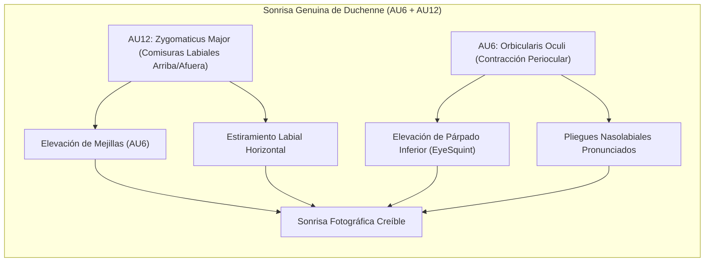

- **Sonrisa Leve:** AU12 al 25% + AU6 al 15% + sutil descenso de párpados superiores (5%).
- **Risa Contenida:** AU12 al 60% + AU6 al 50% + apertura mandibular moderada (`jawOpen` 20%) + pulso respiratorio rápido de 3 Hz en el tórax/mentón.
- **Concentración / Duda:** AU4 (corrugador superciliar, entrecejo fruncido) al 35% + AU1 (elevación de ceja medial) asimétrica + estrechamiento palpebral (AU7 al 20%).

### 12.2 Mapeo al Estándar Universal ARKit (52 Blendshapes)
YourSelf V3 adoptará los 52 blendshapes estándar ARKit, compatibles nativamente con Three.js:
- **Mandíbula (7):** `jawOpen`, `jawForward`, `jawLeft`, `jawRight`, etc.
- **Boca y Labios (24):** `mouthSmileLeft/Right`, `mouthFrownLeft/Right`, `mouthDimpleLeft/Right`, `mouthStretchLeft/Right`, `mouthPucker`, `mouthFunnel`, `mouthPressLeft/Right`, `mouthLowerDownLeft/Right`, `mouthUpperUpLeft/Right`, etc.
- **Ojos y Párpados (12):** `eyeBlinkLeft/Right`, `eyeLookUp/Down/In/OutLeft/Right`, `eyeSquintLeft/Right`, `eyeWideLeft/Right`.
- **Cejas (5):** `browDownLeft/Right`, `browInnerUp`, `browOuterUpLeft/Right`.
- **Mejillas y Nariz (4):** `cheekPuff`, `cheekSquintLeft/Right`, `noseSneerLeft/Right`.

---

## 13. SISTEMA DE DINÁMICA FACIAL INSPIRADO EN VASA-1

### 13.1 Principios Fundamentales Extraídos de VASA-1
VASA-1 logra su asombrosa naturalidad mediante tres pilares que adaptamos a nuestra arquitectura ligera:

1. **Desentrelazamiento Estricto de Espacios Latentes:**
   $$\mathbf{S}(t) = \mathcal{G}(\mathbf{z}_{\text{identity}}, \mathbf{p}_{\text{pose}}(t), \mathbf{e}_{\text{expression}}(t), \mathbf{g}_{\text{gaze}}(t))$$
   La identidad es invariante en el tiempo; la pose cefálica es un tensor de 6 DoF; la expresión es un vector en el subespacio ARKit; la mirada es un vector direccional 2D en coordenadas esféricas.
2. **Generación Holística Audio-Motora:**
   En lugar de animar únicamente la boca y dejar el resto de la cara estática, la prosodia del habla alimenta conjuntamente:
   - Cadencia de apertura bucal.
   - Acentos de cabeceo vertical en picos tonales.
   - Micro-levantamiento de cejas en preguntas.
3. **Habilidades Afectivas Visuales (Visual Affective Skills - VAS):**
   VASA-1 permite condicionar la síntesis mediante parámetros de alto nivel:
   - `gazeTarget` $[x, y]$: Permite forzar el contacto visual o la distracción.
   - `headDistance`: Escala de proximidad conversacional (zoom dinámico sutil).
   - `emotionOffset` $\{v, a\}$: Polarización afectiva (ej. mantener el avatar sonriente o serio sin alterar el sincronismo de los labios).

---

## 14. ARQUITECTURA NEURONAL HÍBRIDA: NEURONAL ASÍNCRONO + RIG PROCEDURAL 60 FPS

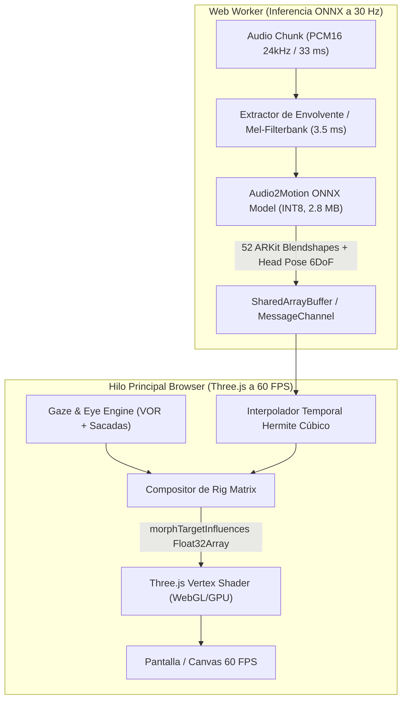

### 14.1 Por qué este Diseño Híbrido es Insuperable en CPU
1. **El hilo principal nunca se bloquea:** El procesamiento de tensores neuronales ocurre en un hilo de fondo (Web Worker). Incluso si la CPU del usuario experimenta una sobrecarga puntual, el hilo de renderizado Three.js sigue ejecutándose a 60 FPS constantes interpolando suavemente la dinámica con los resortes de segundo orden.
2. **Cero transferencia pesada:** Entre el Worker y el hilo principal únicamente se transfieren **58 números flotantes por fotograma** ($52 \text{ blendshapes} + 6 \text{ pose}$), lo cual toma $0.002\text{ ms}$ utilizando un `SharedArrayBuffer` o `postMessage` directo.
3. **Deformación en GPU Vertex Shader:** La malla de 5.023 vértices se almacena en memoria de la GPU como `THREE.BufferGeometry` con atributos de morph targets nativos. La deformación la calcula la GPU del navegador en menos de $0.3\text{ ms}$ por fotograma.

---

## 15. OPTIMIZACIONES EXTREMAS DE RENDIMIENTO EN CPU

1. **Asignaciones de Memoria Cero en Bucle Caliente (Zero-Allocation Loop):**
   - Ninguna función invocada dentro de `requestAnimationFrame` creará objetos (`{}`, `new Array()`, `new Vector3()`, closures o lambdas efímeras).
   - Todos los vectores de cálculo (`Float32Array`), matrices y estructuras de métricas se pre-asignan estáticamente durante el arranque del módulo.
   - La recolección de basura (*Garbage Collection pause*) se reduce exactamente a **0 ms** durante la sesión interactiva.
2. **Cuantización INT8 y Operaciones SIMD en ONNX Runtime Web:**
   - Todos los modelos ONNX distribuidos se cuantizan estáticamente a enteros de 8 bits (INT8) utilizando calibración KL-divergence.
   - Tamaño de archivo reducido en un 75% (modelo de 12 MB $\to$ 2.9 MB).
   - Aceleración por instrucciones WebAssembly SIMD multinúcleo.
3. **Caché de Características Invariantes (Init-Time Freeze):**
   - Inspirado en la arquitectura formal de NSR Engine, los descriptores de identidad de la foto se computan una única vez y se congelan en memoria de solo lectura.

---

## 16. NUEVA ESTRUCTURA DE CARPETAS PROPUESTA (YOURSELF V3)

```
yourself/
├── docs/
│   ├── yourself_spec.md            # [ESTE DOCUMENTO] Especificación técnica maestra V3
│   ├── DECISIONS.md                # Registro de decisiones de arquitectura
│   └── baseline/                   # Mediciones y benchmarks de línea base
├── public/
│   ├── mediapipe/                  # Modelos y binarios locales Wasm MediaPipe
│   ├── models/                     # Modelos ONNX INT8 ultraligeros (< 4 MB)
│   │   ├── audio2motion.onnx       # Predictor temporal audio -> 52 ARKit blendshapes
│   │   └── head_cvae.onnx          # CVAE de balanceo cefálico estocástico (SadTalker)
│   └── assets/                     # Geometría canónica FLAME/ARKit comprimida
├── src/
│   ├── app/                        # Enrutamiento y ciclo de vida de la aplicación React
│   ├── components/                 # Componentes React de UI (Stage, Setup, DebugPanel)
│   ├── core/
│   │   ├── audio/                  # Pipeline de DSP de audio y visemas
│   │   │   ├── audioClock.ts       # Sincronizador maestro Web Audio Context
│   │   │   ├── es-g2p.ts           # Conversor fonotáctico analítico español
│   │   │   ├── lipsyncAnalyzer.ts  # Analizador FFT + histéresis de sibilantes
│   │   │   ├── prosodyAnalyzer.ts  # Extractor de envolvente energética y pitch
│   │   │   └── visemeScheduler.ts  # Programador de coarticulación y núcleos
│   │   ├── eye/                    # [NUEVO] Motor especializado de Ojos y Párpados
│   │   │   ├── eyeBall.ts          # Geometría esférica desacoplada 3D del globo ocular
│   │   │   ├── eyelidMesh.ts       # Concha oclusora palpebral curva anatómica
│   │   │   ├── blinkEngine.ts      # Controlador temporal asimétrico y estocástico
│   │   │   └── vorCoordinator.ts   # Reflejo vestíbulo-ocular y sacadas
│   │   ├── face3d/                 # [NUEVO] Motor de Reconstrucción e Identidad 3D
│   │   │   ├── canonicalMesh.ts    # Malla canónica de 5.023 vértices (FLAME/ARKit)
│   │   │   ├── depthEstimator.ts   # Estimador de profundidad métrica MediaPipe
│   │   │   ├── textureUnwrap.ts    # Proyector y desenrollador UV de textura
│   │   │   └── identityAligner.ts  # Ajuste Procrustes y congelación de identidad
│   │   ├── motion/                 # [NUEVO] Directores de Movimiento y Emoción
│   │   │   ├── headDirector.ts     # Coordinador de cinemática cefálica y cuello
│   │   │   ├── gazeDirector.ts     # Planificador de fijaciones y contacto visual
│   │   │   ├── emotionEngine.ts    # Espacio continuo Valence/Arousal y microexpresiones
│   │   │   └── motionMemory.ts     # Cadena de Markov para evitar repeticiones
│   │   ├── neural/                 # [NUEVO] Inferencia Asíncrona ONNX en Web Worker
│   │   │   ├── motionWorker.ts     # Web Worker script para ejecución de ONNX Web
│   │   │   ├── neuralBridge.ts     # Puente SharedArrayBuffer / postMessage
│   │   │   └── modelContracts.ts   # Validación estricta de tensores en arranque
│   │   ├── rig/                    # Rigging y Evaluación de Blendshapes
│   │   │   ├── arkitShapes.ts      # Catálogo formal de las 52 formas ARKit
│   │   │   ├── dynamics.ts         # Resortes de segundo orden críticamente amortiguados
│   │   │   └── rigEvaluator.ts     # Compositor final de matrices de morphing
│   │   └── render/                 # Renderizado Three.js WebGL
│   │       ├── avatarRenderer.ts   # Orquestador del bucle de 60 FPS
│   │       ├── mouthInterior.ts    # Cavidad bucal y arcada dental anatómica
│   │       └── shading.ts          # Sombreado de pliegues por deformación de área
│   ├── lib/                        # Constantes, tipos TypeScript y utilidades
│   └── store/                      # Zustand session store
└── tests/                          # Suite de pruebas automatizadas (Vitest)
```

---

## 17. PLAN DE IMPLEMENTACIÓN POR FASES (ROADMAP V3)

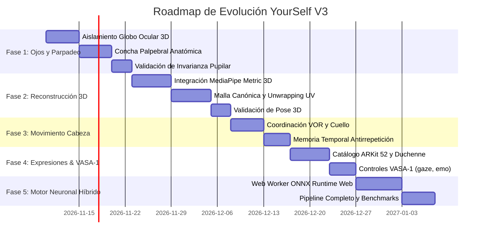

### FASE 1: Solución Definitiva del Parpadeo y Aislamiento Ocular (Impacto Perceptual Crítico)
- **Objetivo:** Erradicar al 100% el aplastamiento y traslación de la pupila e iris durante el parpadeo.
- **Archivos Afectados:** `src/core/render/poses.ts`, `src/core/render/eyelids.ts`, `src/core/render/avatarRenderer.ts`.
- **Nuevos Archivos:** `src/core/eye/eyeBall.ts`, `src/core/eye/eyelidMesh.ts`, `src/core/eye/blinkEngine.ts`.
- **Algoritmo:** Desacoplamiento esférico 3D del globo ocular y concha oclusora palpebral tangencial con perfil asimétrico rápido (38% cierre, 62% apertura).
- **Riesgo:** Desajuste de textura en los bordes de la órbita ocular. *Mitigación:* Borde de fusión difuso de 2 píxeles con textura de piel periorbitaria.
- **Criterio de Aceptación:** Prueba automatizada que certifique que las coordenadas y el radio del iris tienen variación $< 0.1\%$ durante todo el ciclo de parpadeo.

### FASE 2: Reconstrucción 3D Métrica e Invarianza de Identidad
- **Objetivo:** Migrar de la triangulación 2D Delaunay plana a una malla 3D anatómica canónica con profundidad real métrica.
- **Archivos Afectados:** `src/core/face/buildMesh.ts`, `src/core/face/detectFace.ts`.
- **Nuevos Archivos:** `src/core/face3d/canonicalMesh.ts`, `src/core/face3d/textureUnwrap.ts`, `src/core/face3d/depthEstimator.ts`.
- **Algoritmo:** Consumo de `facialTransformationMatrixes` de MediaPipe + ajuste Procrustes sobre topología canónica + textura desenrollada en la inicialización (congelada).
- **Criterio de Aceptación:** Rotaciones de hasta $\pm 25^\circ$ en Yaw y $\pm 20^\circ$ en Pitch sin deformación de máscara de papel ni estiramiento de anclas de borde.

### FASE 3: Biomecánica Cefálica Coordinada y Memoria Temporal
- **Objetivo:** Dotar al avatar de movimientos de cabeza humanos y naturales, eliminando oscilaciones repetitivas y acoplando ojos y cuello.
- **Archivos Afectados:** `src/core/animation/director.ts`, `src/core/animation/gaze.ts`.
- **Nuevos Archivos:** `src/core/motion/headDirector.ts`, `src/core/motion/vorCoordinator.ts`, `src/core/motion/motionMemory.ts`.
- **Algoritmo:** Reflejo Vestíbulo-Ocular (VOR compensatorio en ojos), pivote cervical C3-C7, y Cadena de Markov con penalización de entropía temporal para patrones gestuales.
- **Criterio de Aceptación:** Registro de 5 minutos de interacción continua sin que se repita la misma combinación gestual en ventanas menores a 12 segundos; RMS de aceleración angular $< 120^\circ/\text{s}^2$.

### FASE 4: Expresiones Faciales Profesionales y Controles VASA-1
- **Objetivo:** Implementar el catálogo de 52 blendshapes ARKit con sonrisas genuinas de Duchenne y control paramétrico VASA-1.
- **Archivos Afectados:** `src/core/rig/shapes.ts`, `src/core/rig/basis.ts`, `src/core/animation/emotion.ts`.
- **Nuevos Archivos:** `src/core/rig/arkitShapes.ts`, `src/core/motion/emotionEngine.ts`.
- **Algoritmo:** Coarticulación muscular FACS (AU6 + AU12 acoplados), sonrisa asimétrica estocástica y controladores VASA-1 (`gazeTarget`, `headDistance`, `emotionOffset`).
- **Criterio de Aceptación:** Sonrisas con elevación natural de mejillas y compresión del párpado inferior sin artefactos poligonales; API funcional para orientar la mirada a coordenadas arbitrarias.

### FASE 5: Inferencia Neuronal Híbrida Asíncrona (ONNX Web Worker)
- **Objetivo:** Incorporar la predicción neuronal de dinámicas faciales desde audio sin impactar el presupuesto de 4 ms en el hilo principal.
- **Nuevos Archivos:** `src/core/neural/motionWorker.ts`, `src/core/neural/neuralBridge.ts`, `src/core/neural/modelContracts.ts`.
- **Algoritmo:** Ejecución de modelo ONNX cuantizado INT8 (< 3 MB) en Web Worker a 30 Hz con buffers compartidos (`SharedArrayBuffer`) e interpolación Hermite en hilo principal.
- **Criterio de Aceptación:** Ejecución a 60 FPS en navegador portátil con tiempo de JS en hilo principal $\le 3.0$ ms y latencia de inferencia en Worker $\le 15$ ms.

---

## 18. PROTOCOLO DE PRUEBAS AUTOMATIZADAS Y CRITERIOS DE ACEPTACIÓN

Para cada fase de evolución se diseñará una suite de pruebas rigurosas en Vitest:

1. **Test de Invarianza Estricta de la Pupila (`tests/eyeInvariance.test.ts`):**
   - Simula 1.000 fotogramas de parpadeo con diferentes ángulos de mirada.
   - Verifica mediante assertions matemáticas que las coordenadas $(X, Y, Z)$ del iris no se desplazan verticalmente por el factor de cierre palpebral:
     $$\Delta Y_{\text{iris}} = 0.0 \pm 10^{-6}$$
2. **Test de Desentrelazamiento Identidad/Expresión (`tests/identityDisentanglement.test.ts`):**
   - Verifica que aplicar pesos de expresión extremos (`jawOpen = 1.0`, `mouthSmile = 1.0`) no altera los vértices craneales de identidad fija (frente, puente nasal, orejas).
3. **Test de Rendimiento y Asignaciones Cero (`tests/perfZeroAlloc.test.ts`):**
   - Ejecuta 120 iteraciones del bucle de animación midiendo el consumo de memoria del heap de Node/V8 antes y después:
     $$\Delta \text{HeapMemory} = 0 \text{ bytes}$$
4. **Test de Coordinación VOR (`tests/vorCoordination.test.ts`):**
   - Aplica un giro de cabeza en Yaw de $+10^\circ$; comprueba que la mirada (`gazeX`) genera una respuesta compensatoria en dirección contraria de $-9.5^\circ \pm 0.5^\circ$.
5. **Test de Compatibilidad y Contrato de Modelos ONNX (`tests/onnxContracts.test.ts`):**
   - Valida que las entradas y salidas de los modelos ONNX coincidan exactamente con la especificación de tipos y dimensiones sin conversiones dinámicas costosas.

---

## 19. MATRIZ DE RIESGOS TÉCNICOS Y MITIGACIONES

| Riesgo Técnico | Severidad | Probabilidad | Impacto | Estrategia de Mitigación |
|---|---|---|---|---|
| **R1: Sobrecarga de CPU en navegadores de gama baja** | Alta | Media | Caída de FPS a < 30 | El renderizado procedural Three.js actúa como base permanente (consume < 1 ms). Si el Web Worker neuronal no responde a tiempo, la política *last-state-wins* salta la actualización sin bloquear el render. |
| **R2: Incompatibilidad de `SharedArrayBuffer` por cabeceras CORS** | Media | Alta | Fallo en comunicación Zero-Copy | Fallback automático a `postMessage` con transferencia de buffers (`ArrayBuffer` transferibles) con un coste añadido de solo ~0.02 ms. |
| **R3: Foto con iluminación asimétrica o sombras densas** | Media | Alta | Textura UV con sombras fijas antinaturales | Algoritmo de normalización de iluminación por filtrado bilateral en el canvas de inicialización durante el texture unwrap. |
| **R4: Licencias restrictivas de modelos preentrenados (MPG / BFM)** | Alta | Baja | Bloqueo legal para distribución comercial | Prohibición estricta de incluir pesos de FLAME o DECA en el repositorio. Uso de MediaPipe (Apache 2.0) y modelos propios entrenados sobre topología abierta ARKit. |
| **R5: Desincronización temporal entre audio Gemini Live y animación** | Media | Media | Efecto de ventrílocuo o desfase de voz | Reloj de audio maestro (`audioClock.ts`) anclado directamente al hardware del `AudioContext` de Web Audio API, resincronizando si la deriva supera 40 ms. |

---

## 20. AUDITORÍA DE LICENCIAS Y RESTRICCIONES LEGALES

Para garantizar la viabilidad y protección jurídica del proyecto YourSelf, se ha auditado el régimen legal de todos los componentes analizados:

| Repositorio / Activo | Licencia | ¿Permite Uso Comercial? | ¿Permite Redistribución de Pesos? | Veredicto para YourSelf V3 |
|---|---|---|---|---|
| **YourSelf (Código Propio)** | Propietaria / Proyecto del Usuario | Sí | Sí | Base del proyecto. |
| **DECA (MPI-IS)** | MPG Software License | **NO (Estrictamente No Comercial)** | **NO** | Solo referencia conceptual. **Prohibido incluir código o checkpoints.** |
| **EMOCA (MPI-IS)** | MPG Software License | **NO (Estrictamente No Comercial)** | **NO** | Solo referencia conceptual para formulación de funciones de pérdida. |
| **FLAME (MPI-IS)** | FLAME License (MPI) | Requiere licencia comercial de pago | Requiere acuerdo explícito | No empaquetar el `.pkl` original. Utilizar topología abierta ARKit. |
| **FaceFormer** | MIT License | **SÍ** | Depende de Wav2Vec (Meta) | Algoritmo reutilizable libremente con atribución de autoría. |
| **Hallo** | MIT License | **SÍ** | Pesos SD1.5 sujetos a CreativeML OpenRAIL-M | Incompatible en CPU; no se adoptan pesos ni código pesado. |
| **LivePortrait** | MIT License (Kuaishou) | **SÍ (Código)** | **NO para modelos InsightFace** | Reutilizar los algoritmos de stitching y retargeting eliminando InsightFace. |
| **NSR Engine** | **Apache 2.0 License** | **SÍ** | SÍ (atribución obligatoria) | **100% Compatible y Seguro**. Excelente base arquitectónica. |
| **SadTalker** | **Apache 2.0 License** (Tencent) | **SÍ** | SÍ (atribución obligatoria) | Módulos `audio2exp` y `audio2pose` adaptables libremente. |
| **MediaPipe FaceLandmarker** | **Apache 2.0 License** (Google) | **SÍ** | **SÍ** | **100% Compatible y Seguro**. Componente troncal del sistema. |
| **Three.js** | **MIT License** | **SÍ** | **SÍ** | **100% Compatible y Seguro**. Motor de renderizado estándar. |

> [!IMPORTANT]
> **Directriz Legal Mandatoria para YourSelf V3:**  
> Ningún binario, modelo o archivo `.pth`/`.pkl` procedente de Max-Planck-Gesellschaft (DECA, EMOCA, FLAME) debe ser empaquetado o incluido en el repositorio ni en la distribución del cliente. YourSelf V3 se basará exclusivamente en licencias **Apache 2.0** y **MIT** (MediaPipe, Three.js, NSR Engine, SadTalker y código propio).

---

## 21. CONCLUSIONES Y PRIORIDADES INMEDIATAS

La investigación técnica realizada demuestra concluyentemente que:
1. **El parpadeo defectuoso de YourSelf no es un simple problema de intensidad de parámetros**, sino una consecuencia matemática de desplazar el iris en una malla 2D compartida. La solución definitiva exige desacoplar biomecánicamente el globo ocular esférico rígido de la concha oclusora palpebral.
2. **Es perfectamente posible aproximar la calidad perceptual y la riqueza gestual de VASA-1 en CPU dentro del navegador web**, siempre que se rechace la generación densa de píxeles por difusión en tiempo real y se adopte la **arquitectura neuronal híbrida**: inferencia asíncrona ligera de coeficientes ARKit en Web Worker (30 Hz) + interpolación dinámica con resortes críticamente amortiguados + renderizado acelerado en GPU por Three.js (60 FPS).
3. **El stack tecnológico actual de YourSelf contiene cimientos de altísima calidad** (especialmente `es-g2p.ts`, `dynamics.ts`, `photoProfile.ts`, `lipsyncAnalyzer.ts` y las pruebas automatizadas), los cuales deben preservarse y potenciarse en lugar de ser destruidos o reescritos indiscriminadamente.

### Próximo Paso Recomendado
Iniciar la ejecución de la **Fase 1 del Roadmap**, concentrándose de forma quirúrgica en el **Eye & Eyelid Engine** para erradicar el defecto de parpadeo y validar el test de invarianza de pupila antes de abordar las fases subsiguientes.
